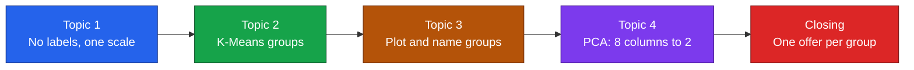
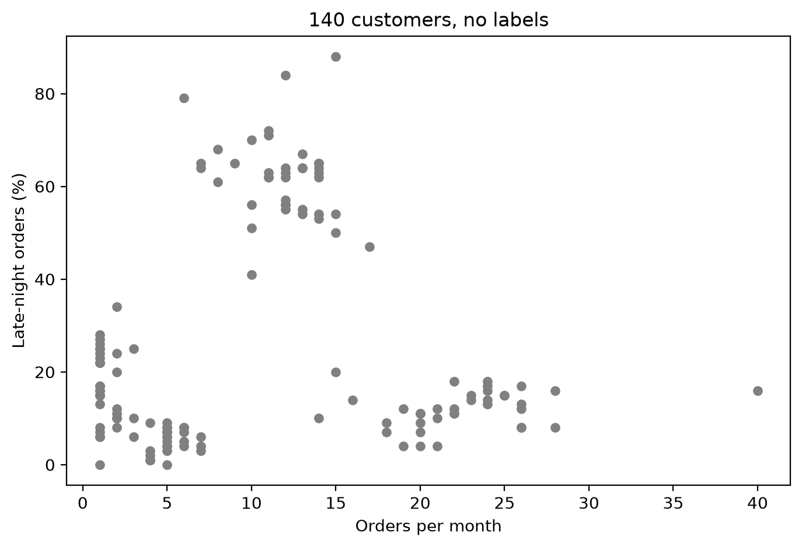
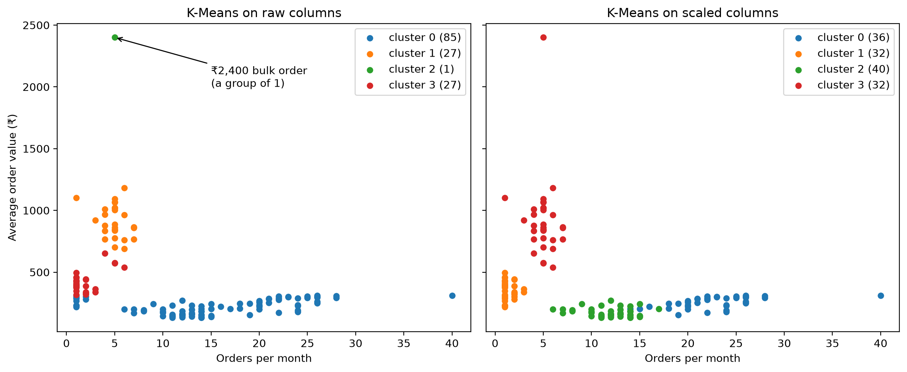
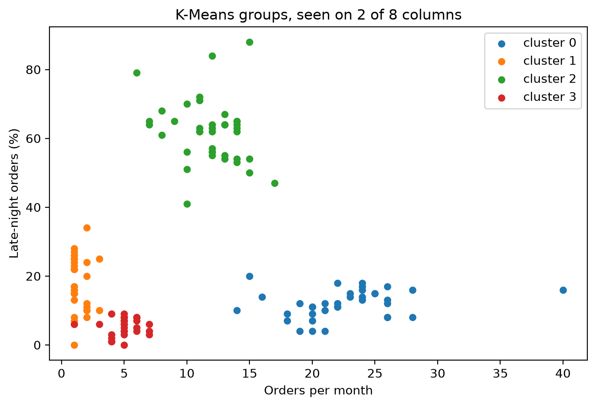
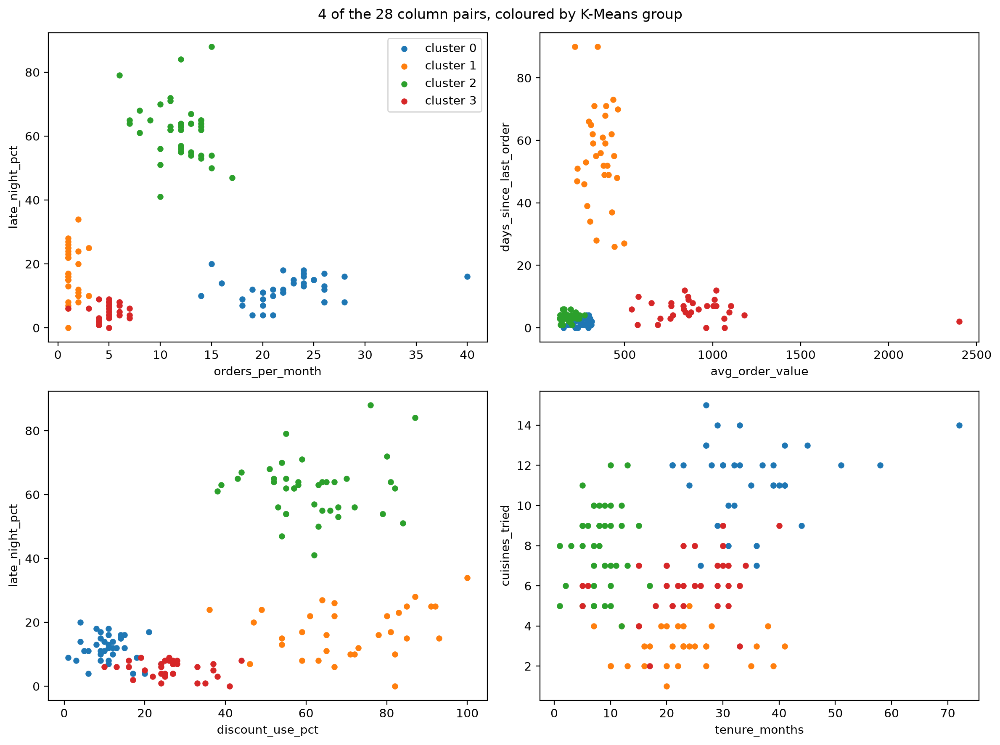
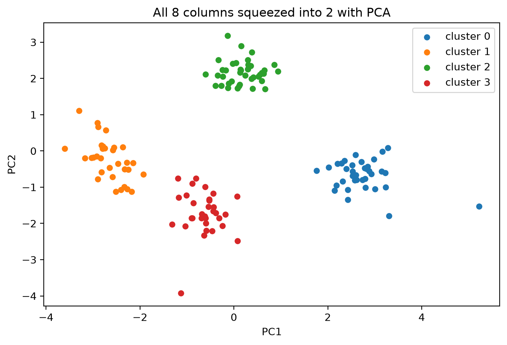
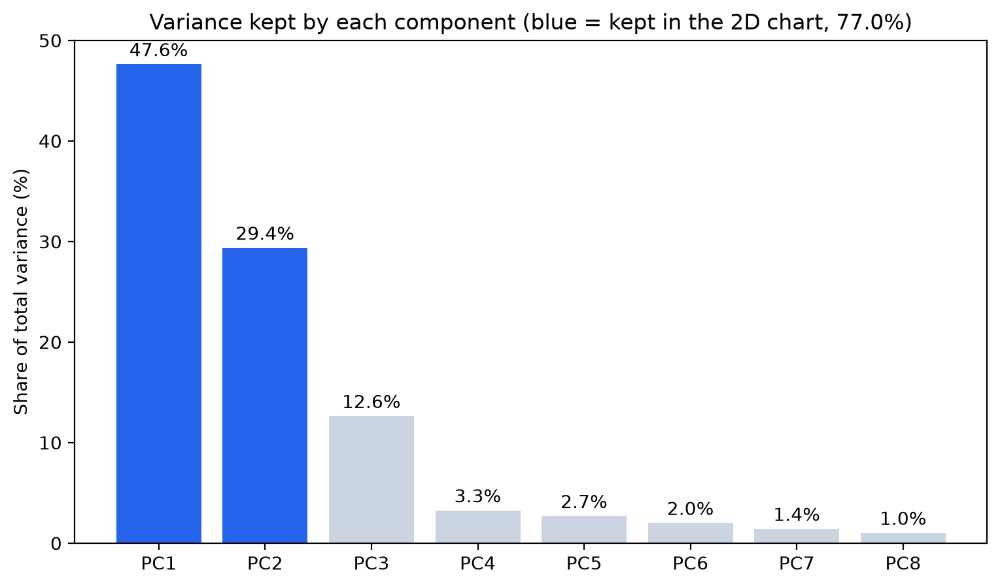

# <font color='#1d4ed8'>Lecture Script: Unsupervised Learning - Clustering and Dimensionality Reduction</font>

---

## <font color='blue'>Agenda</font>

The lecture runs as four topics. Each topic ends with a quiz.

| Topic | What we do | Learning objectives covered | Minutes |
|:-:|:--|:--|:-:|
| 1 | Meet data with no labels and put every column on one scale | Understand what unsupervised learning is and why it is useful when data has no labels | 20 |
| 2 | Group the customers with K-Means | apply K-Means clustering to group similar data points together using Scikit-learn in Google Colab | 30 |
| 3 | Plot the groups, name them, and hit the limit of 2D charts | visualise the resulting clusters using Matplotlib and describe in plain language what each group might represent<br>understand why datasets with many features can be hard to visualise and work with | 25 |
| 4 | Squeeze 8 columns into 2 with PCA and read what was kept | use Principal Component Analysis (PCA) to reduce a dataset down to two or three key dimensions using Scikit-learn in Google Colab<br>plot the reduced data using Matplotlib and explain what information was preserved after reduction | 35 |
| — | Closing: Outcome & Summary | | 10 |
| | **Total** | | **120** |

> <font color="red">**🎯 Instructor Note**</font> Pace: keep Topic 1 quick (learners have already met supervised vs unsupervised); spend the most time on K-Means (Topic 2) and PCA (Topic 4).

---

## <font color='blue'>Scenario</font>

A Swiggy-style food delivery app wants to send each customer an offer that fits how they order. The growth team has a table of 140 customers. Here is what they have, and what they do not:

| The team has | The team does not have |
|:--|:--|
| 8 behaviour columns per customer: orders per month, average order value (₹), % of orders placed late at night, % of orders that used a discount, cuisines tried, days since last order, months on the app, app opens per week | Any column that says what *kind* of customer a person is |
| 140 rows, one per customer | A "right answer" to check a model against |
| One week to plan the offers | Time to read 140 rows by hand |

> <font color="red">**🎯 Instructor Note**</font> The company is only the setting; the 140 customers in `food_app_customers.csv` are invented for teaching. Ask learners to upload the file to Colab before Topic 1 (outputs below came from scikit-learn 1.9.1).

---

## <font color='blue'>Problem Statement</font>

Last month the team sent the same 30% coupon to every customer. Customers who already order almost every day used it on meals they would have bought anyway, so the app paid for nothing. Customers who had stopped opening the app never even saw it. One offer for everyone cost money and won nobody back.

> <font color='purple'>**With no column that tells us what kind of customer anyone is, how do we find the natural groups of customers, and how do we see all 8 columns of them on one chart?**</font>

> <font color="red">**🎯 Instructor Note**</font> Poll: "How many different kinds of customers do you think are hiding in these 140 rows: 2, 3, 4, or 5 or more?" Give learners 30 seconds to respond in chat. Reveal the answer in the Closing.

---

## <font color='blue'>What We Will Use</font>

Everything runs in Google Colab with Pandas, Scikit-learn and Matplotlib.

| Topic | Tools | In one line |
|:-:|:--|:--|
| 1 | `pd.read_csv`, `StandardScaler` | Load the table and put all 8 columns on the same scale |
| 2 | `KMeans` | Split the customers into k groups of similar rows |
| 3 | `groupby().mean()`, `plt.scatter` | Describe each group by its averages and plot it |
| 4 | `PCA`, `explained_variance_ratio_` | Turn 8 columns into 2 new ones and measure how much information they keep |

---

## <font color='blue'>How: Walking Through the Food App's Customer Table</font>



---

## <font color='blue'>Topic 1: Data With No Labels</font> `20 min`

> <font color='purple'>**Every model you have trained so far learned from a column holding the right answer. What can a model learn when that column does not exist?**</font>

In an earlier session you split a dataset into input features and a target label. You also saw that learning *without* labels is called unsupervised learning. Since then, every model you trained (linear regression, logistic regression, decision trees, random forests) learned from a target column. Last session's confusion matrix worked only because we knew the true answer for every row. Today there is no answer column.

### <font color='green'>Example: Look at the customer table</font>

> <font color='purple'>**Which column in this table would we ask a model to predict?**</font>

**Predict before running: What will happen?**

> <font color="red">**🎯 Instructor Note**</font> Expected: 140 rows, 9 columns, and no column like "customer_type". A common wrong guess is that `discount_use_pct` is the label; it is just another behaviour.

```python
import pandas as pd
df = pd.read_csv("food_app_customers.csv")
print(df.shape)
print(df.head(3).T)
```

**Output**

```
(140, 9)
                          0     1     2
customer_id            C001  C002  C003
orders_per_month          1    12     2
avg_order_value         455   272   280
late_night_pct           22    62     8
discount_use_pct         67    55    59
cuisines_tried            2     6     4
days_since_last_order    48     4    53
tenure_months            13     2    22
app_opens_per_week        3    23     1
```

#### <font color='#c2410c'>Code Explanation</font>

- **Lines 1–2** Load the CSV into a DataFrame, as you did in the Pandas sessions.
- **Line 3** 140 customers, 9 columns: one ID and 8 behaviour columns.
- **Line 4** `.T` flips the first 3 rows on their side so all 9 columns fit on screen.

> <font color='green'>**Result**</font> There is no target column. Nothing tells us that customer C001 is a "regular" or a "lapsed" customer, so there is no answer to learn from and nothing to score against.

<p align="center"></p>

#### <font color='#c2410c'>Logic Explanation</font>

| | Supervised learning | Unsupervised learning |
|:--|:--|:--|
| What each row has | Features **and** a label | Features only |
| What the model does | Learns to copy the label | Looks for patterns on its own |
| How we check it | Compare predictions with true labels (MAE, accuracy, F1) | No answer key; we judge whether the groups make sense |
| Example | Will this customer default? | Which customers behave alike? |

Unsupervised learning is useful because most real data has no labels. Nobody has tagged these 140 customers by type. Tagging them by hand would be slow, and the guesses could be wrong. **Clustering** is the most common kind of unsupervised learning. It puts rows into groups so that rows in the same group are alike and rows in different groups are not.

### <font color='green'>Extending it: Are the columns on comparable scales?</font>

> <font color='purple'>**"Alike" will mean "close together". Does a difference of 10 mean the same thing in every column?**</font>

> <font color="red">**🎯 Instructor Note**</font> Ask first: "Which column has the biggest numbers?" Expected: `avg_order_value`, in rupees, ranging into the thousands.

```python
from sklearn.preprocessing import StandardScaler
X = df.drop(columns="customer_id")
print(X.describe().loc[["min", "max", "std"]].round(1).T)
X_scaled = StandardScaler().fit_transform(X)
print(abs(X_scaled.mean(axis=0)).round(2))
print(X_scaled.std(axis=0).round(2))
```

**Output**

```
                         min     max    std
orders_per_month         1.0    40.0    8.5
avg_order_value        132.0  2400.0  325.5
late_night_pct           0.0    88.0   24.1
discount_use_pct         1.0   100.0   26.8
cuisines_tried           1.0    15.0    3.4
days_since_last_order    0.0    90.0   23.2
tenure_months            1.0    72.0   12.8
app_opens_per_week       0.0    38.0    9.6
[0. 0. 0. 0. 0. 0. 0. 0.]
[1. 1. 1. 1. 1. 1. 1. 1.]
```

#### <font color='#c2410c'>Code Explanation</font>

- **Line 2** Drop the ID: `C001` says nothing about behaviour, so it must not affect the groups.
- **Line 3** Smallest value, largest value and spread (standard deviation) of each column. `avg_order_value` spreads by hundreds of rupees; `cuisines_tried` spreads by about 3.
- **Line 4** `StandardScaler`, from the preprocessing session, turns each column into $z = \dfrac{x - \text{mean}}{\text{std}}$.
- **Lines 5–6** After scaling, every column has mean 0 and standard deviation 1.

> <font color='green'>**Result**</font> Before scaling, ₹100 of order value would count 100 times more than 1 extra cuisine tried. After scaling, every column counts equally. We keep `X_scaled` for the rest of the lecture.

### <font color='purple'>Quiz 1</font>

**Question:** Which of these tasks is unsupervised learning?

**Options:**
- A) Predicting a customer's next order value from their past orders
- B) Grouping customers by how they order when no one has labelled any customer
- C) Predicting whether a customer will cancel, using last year's "cancelled: yes/no" column
- D) Scoring a classifier with a confusion matrix

**Correct Answer:** B

**Explanation:**
- **A)** Wrong: the order value is a known number to predict, so this is supervised regression.
- **B)** Correct: there is no label column; the model must find the groups from features alone.
- **C)** Wrong: the "cancelled" column is a label, so this is supervised classification.
- **D)** Wrong: a confusion matrix needs true labels, which is exactly what unsupervised data lacks.

---

## <font color='blue'>Topic 2: Grouping Customers With K-Means</font> `30 min`

> <font color='purple'>**Every column now has the same scale. How does a model decide which customers belong together?**</font>

### <font color='green'>Example: Fit K-Means with 4 groups</font>

> <font color='purple'>**If the team can run four different offers, which four groups of customers does the data suggest?**</font>

K-Means works like this:

1. Drop $k$ centre points among the customers.
2. Assign every row to its nearest centre.
3. Move each centre to the average of the rows assigned to it.
4. Repeat 2 and 3 until no row changes group.

K-Means tries to make one number as small as possible. That number is the **inertia**: add up the squared distance from each customer to its own group centre.

$$\boxed{\text{inertia} = \sum_{i=1}^{n} \lVert x_i - c_{k(i)} \rVert^2}$$

Here $x_i$ is customer $i$ (8 scaled numbers), and $c_{k(i)}$ is the centre of that customer's group. Small inertia means customers sit close to their group centres.

**Predict before running: What will happen?**

> <font color="red">**🎯 Instructor Note**</font> Expected: 140 group numbers from 0 to 3. Learners often expect 35 per group; K-Means does not force equal sizes.

```python
from sklearn.cluster import KMeans
kmeans = KMeans(n_clusters=4, n_init=10, random_state=42)
labels = kmeans.fit_predict(X_scaled)
print(labels[:10])
print(pd.Series(labels).value_counts().sort_index())
print(round(kmeans.inertia_, 1))
```

**Output**

```
[1 2 1 2 0 1 0 1 0 0]
0    36
1    32
2    40
3    32
Name: count, dtype: int64
199.2
```

#### <font color='#c2410c'>Code Explanation</font>

- **Line 2** `n_clusters=4` is $k$, which *we* choose. `n_init=10` tries 10 different starting points and keeps the best result (lowest inertia). `random_state=42` gives the same result every time you run it.
- **Line 3** `fit_predict` is the `fit` then `predict` pattern you already know. The difference: we give it only `X_scaled`. There is no `y`.
- **Line 4** The group number for the first 10 customers.
- **Line 5** How many customers landed in each group.
- **Line 6** The inertia of the best run. On its own the number has no units to read; it is useful for comparing runs on the same data.

> <font color='green'>**Result**</font> K-Means split the 140 customers into four groups of 36, 32, 40 and 32, using only their behaviour.

> <font color='#b45309'>**Common mistake**</font> Treating the group *numbers* as meaningful. "Cluster 2" is just a name tag. Another version of the library may give the same group a different number. Describe a group by its averages, never by its number.

### <font color='green'>Extending it: What if we skip scaling?</font>

> <font color='purple'>**Same data, same k, but the raw columns. Do we get the same groups?**</font>

> <font color="red">**🎯 Instructor Note**</font> Poll first: "Same groups or different?" Expected: very different, with one group holding a single customer.

```python
raw_labels = KMeans(n_clusters=4, n_init=10, random_state=42).fit_predict(X)
print(pd.Series(raw_labels).value_counts().sort_index())
tiny = pd.Series(raw_labels).value_counts().idxmin()
print(df.loc[raw_labels == tiny, ["customer_id", "avg_order_value"]])
```

**Output**

```
0    85
1    27
2     1
3    27
Name: count, dtype: int64
   customer_id  avg_order_value
16        C017             2400
```

#### <font color='#c2410c'>Code Explanation</font>

- **Line 1** K-Means on `X`, the unscaled columns.
- **Line 2** The group sizes are very uneven.
- **Lines 3–4** Find the smallest group and show who is in it.

> <font color='green'>**Result**</font> Without scaling, order value in rupees decides almost everything. One office bulk order of ₹2,400 gets a group of its own, and real behaviour such as late-night ordering is ignored.

<p align="center"></p>

### <font color='green'>Extending it: What if the team can only run 3 offers?</font>

> <font color='purple'>**With k = 3, which of today's four groups get merged?**</font>

> <font color="red">**🎯 Instructor Note**</font> Ask learners to guess from the sizes 36, 32, 40, 32 before running. Expected: two groups join into one of 64.

```python
labels3 = KMeans(n_clusters=3, n_init=10, random_state=42).fit_predict(X_scaled)
print(pd.crosstab(labels, labels3, rownames=["k=4"], colnames=["k=3"]))
```

**Output**

```
k=3   0   1   2
k=4            
0    36   0   0
1     0  32   0
2     0   0  40
3     0  32   0
```

#### <font color='#c2410c'>Code Explanation</font>

- **Line 1** The same model with $k = 3$.
- **Line 2** `pd.crosstab` counts how the k = 4 groups (rows) fall into the k = 3 groups (columns).

> <font color='green'>**Result**</font> Groups 1 and 3 from k = 4 merge into one group of 64. The other two groups stay exactly as they were. K-Means always returns exactly the $k$ groups you ask for, so choosing $k$ is your decision. Here it comes from how many offers the team can run.

### <font color='purple'>Quiz 2</font>

**Question:** A teammate runs K-Means with k = 4 on the raw (unscaled) customer columns and gets one group containing a single customer. What is the most likely cause?

**Options:**
- A) K-Means needs a label column and is guessing without one
- B) `n_init=10` is too small, so the run never finished
- C) `avg_order_value` is in rupees and has a much larger spread than the other columns, so one extreme order decides the distances
- D) k = 4 is too many clusters for 140 rows

**Correct Answer:** C

**Explanation:**
- **A)** Wrong: K-Means never uses labels; that is what makes it unsupervised.
- **B)** Wrong: `n_init` is how many starting points to try; each try runs until no customer changes group.
- **C)** Correct: the column with the biggest numbers controls the distance, so the ₹2,400 order sits far from everyone.
- **D)** Wrong: the same k = 4 on scaled data gave four sensible groups of 32 to 40 customers.

---

## <font color='blue'>Topic 3: Seeing and Naming the Groups</font> `25 min`

> <font color='purple'>**K-Means gave us four groups of 36, 32, 40 and 32. What kind of customer is in each one?**</font>

### <font color='green'>Example: Describe each group by its averages</font>

> <font color='purple'>**What does a typical customer in each group look like?**</font>

**Predict before running: What will happen?**

> <font color="red">**🎯 Instructor Note**</font> Expected: one row per behaviour column and one column per group. It is the same `groupby().mean()` from the data exploration session.

```python
df["cluster"] = labels
profile = df.groupby("cluster")[X.columns].mean().round(0)
print(profile.T)
```

**Output**

```
cluster                    0      1      2      3
orders_per_month        23.0    1.0   12.0    5.0
avg_order_value        255.0  358.0  175.0  916.0
late_night_pct          12.0   17.0   62.0    5.0
discount_use_pct        11.0   71.0   62.0   26.0
cuisines_tried          11.0    3.0    8.0    6.0
days_since_last_order    2.0   55.0    3.0    6.0
tenure_months           35.0   23.0    8.0   24.0
app_opens_per_week      25.0    2.0   17.0    6.0
```

#### <font color='#c2410c'>Code Explanation</font>

- **Line 1** Store each customer's group number as a new column.
- **Line 2** Average every behaviour column inside each group. We use the **original** numbers (not the scaled ones) so they are easy to read.
- **Line 3** `.T` puts groups across the top so each group reads as one column.

#### <font color='#c2410c'>Logic Explanation</font>

Read each group's column in the table and describe it in plain words. We choose these names; K-Means only gives numbers.

| Cluster | What stands out | Our plain-language name |
|:-:|:--|:--|
| 0 | ~23 orders a month, opens the app ~25 times a week, rarely uses discounts | Daily regulars |
| 1 | ~1 order a month, last order ~55 days ago, uses discounts on ~70% of orders | Lapsed users |
| 2 | ~12 cheap orders a month, ~60% late at night, discount on ~60%, newest on the app | Late-night deal-seekers |
| 3 | ~5 orders a month, but ~₹900 each, rarely late at night | Weekend family orders |

> <font color='green'>**Result**</font> Each group has a clear story. Daily regulars do not need a coupon; lapsed users might return for one.

### <font color='green'>Extending it: Plot the groups with Matplotlib</font>

> <font color='purple'>**Can we see the four groups on a chart?**</font>

> <font color="red">**🎯 Instructor Note**</font> Ask before running: "Will all four colours sit apart?" Expected: two groups stand apart; two crowd together in the bottom-left corner.

```python
import matplotlib.pyplot as plt
plt.figure(figsize=(8, 5))
for c in range(4):
    part = df[df["cluster"] == c]
    plt.scatter(part["orders_per_month"], part["late_night_pct"], s=25, label=f"cluster {c}")
plt.xlabel("Orders per month")
plt.ylabel("Late-night orders (%)")
plt.legend()
plt.title("K-Means groups, seen on 2 of 8 columns")
plt.show()
```

**Output**

<p align="center"></p>

#### <font color='#c2410c'>Code Explanation</font>

- **Line 3** Loop over the four groups so each gets its own colour and legend entry.
- **Line 4** Keep only the rows of this group.
- **Line 5** Plot two of the eight columns for those rows.
- **Lines 6–10** Labels, legend and title, as in the Matplotlib session.

> <font color='green'>**Result**</font> Daily regulars (0) and late-night deal-seekers (2) stand apart. Lapsed users (1) and weekend family orders (3) sit close together and almost touch, because on *these two* columns they look alike: few orders, few late-night orders.

### <font color='green'>Extending it: Why not just plot every pair of columns?</font>

> <font color='purple'>**Groups 1 and 3 almost touch on this chart. How many charts would it take to check every pair of columns?**</font>

> <font color="red">**🎯 Instructor Note**</font> Let learners guess in chat: most say 8 or 16. Give learners 30 seconds to respond in chat.

```python
from itertools import combinations
pairs = list(combinations(X.columns, 2))
print(len(pairs))
print(pairs[:3])
```

**Output**

```
28
[('orders_per_month', 'avg_order_value'), ('orders_per_month', 'late_night_pct'), ('orders_per_month', 'discount_use_pct')]
```

#### <font color='#c2410c'>Code Explanation</font>

- **Line 2** `combinations` lists every pair of the 8 columns once.
- **Line 3** The count of pairs: $\binom{8}{2} = \dfrac{8 \times 7}{2} = 28$.
- **Line 4** The first three pairs, as an example.

<p align="center"></p>

> <font color='green'>**Result**</font> 28 charts, and each one shows only a slice. Average order value against days since last order pulls groups 1 and 3 far apart but piles groups 0 and 2 on top of each other; months on the app against cuisines tried mixes several groups. To be sure of the picture you would have to read all 28.

#### <font color='#c2410c'>Logic Explanation</font>

Each customer has 8 numbers, so drawing one customer properly would need 8 axes. A screen has only 2. With many features, data is:

- **Hard to see:** the number of pair charts grows fast. 8 columns give 28 pairs; 20 columns give 190.
- **Hard to work with:** many columns often repeat the same information. Customers who order often also open the app often and try more cuisines, so three columns are telling one story.

### <font color='purple'>Quiz 3</font>

**Question:** One cluster's averages are: orders per month 1, days since last order 55, discount use 70%, app opens per week 2. Which plain-language description fits best?

**Options:**
- A) Customers who have mostly stopped ordering and react mainly to discounts
- B) Loyal customers who order almost every day
- C) Big-basket family customers who order rarely but spend a lot
- D) New customers who just installed the app

**Correct Answer:** A

**Explanation:**
- **A)** Correct: very few orders, a long gap since the last one and heavy discount use describe lapsed, discount-driven users.
- **B)** Wrong: daily customers would show many orders and a gap of a day or two.
- **C)** Wrong: nothing in these averages mentions order value, and frequent discount use does not suggest a big spender.
- **D)** Wrong: new customers would have few months on the app and a recent first order, not a 55-day gap.

---

## <font color='blue'>Topic 4: PCA, Eight Columns Into Two</font> `35 min`

> <font color='purple'>**Checking the groups pair by pair takes 28 charts. Can we build two *new* columns that carry most of the information in all eight?**</font>

### <font color='green'>Example: Reduce to 2 dimensions with PCA</font>

> <font color='purple'>**How much of the customers' spread can two new columns keep?**</font>

**Principal Component Analysis (PCA)** builds new columns called **principal components**. Each one is a mix of all 8 scaled columns, with a weight for each.

- **PC1** is the direction in which customers differ the most.
- **PC2** is the direction in which they differ the most after that, using only information PC1 has not already captured.
- PCA does **not** pick 2 of the 8 columns. It blends all 8.

Columns that move together (orders, app opens, cuisines) repeat the same information, so a few components can hold most of it.

$$\boxed{\text{explained variance ratio of PC}_j = \frac{\text{variance along PC}_j}{\text{total variance of all columns}}}$$

In plain words: the share of all the differences between customers that one component carries.

**Predict before running: What will happen?**

> <font color="red">**🎯 Instructor Note**</font> Expected: shape goes from (140, 8) to (140, 2), and the two ratios add to less than 1. Some learners expect exactly 0.25 (2 of 8 columns).

```python
from sklearn.decomposition import PCA
pca = PCA(n_components=2)
X_2d = pca.fit_transform(X_scaled)
print(X_scaled.shape, "->", X_2d.shape)
print(pca.explained_variance_ratio_.round(3))
print(round(pca.explained_variance_ratio_.sum(), 3))
```

**Output**

```
(140, 8) -> (140, 2)
[0.476 0.294]
0.77
```

#### <font color='#c2410c'>Code Explanation</font>

- **Line 2** Ask for 2 components.
- **Line 3** Fit PCA on the **scaled** data and transform every customer into 2 numbers.
- **Line 4** 140 customers, now 2 columns each instead of 8.
- **Line 5** PC1 keeps 47.6% of the total variance and PC2 keeps 29.4%.
- **Line 6** Together they keep 77.0%.

> <font color='green'>**Result**</font> Two columns instead of eight, and 77% of the differences between customers are kept. The other 23% is in the six components we dropped.

### <font color='green'>Extending it: Plot the reduced data</font>

> <font color='purple'>**On the two PCA columns, do the four K-Means groups separate?**</font>

> <font color="red">**🎯 Instructor Note**</font> Remind learners that PCA never saw the group labels; we use them only to colour the dots. Ask: "Will groups 1 and 3 still sit close?"

```python
plt.figure(figsize=(8, 5))
for c in range(4):
    part = X_2d[labels == c]
    plt.scatter(part[:, 0], part[:, 1], s=25, label=f"cluster {c}")
plt.xlabel("PC1")
plt.ylabel("PC2")
plt.legend()
plt.title("All 8 columns squeezed into 2 with PCA")
plt.show()
```

**Output**

<p align="center"></p>

#### <font color='#c2410c'>Code Explanation</font>

- **Line 3** `X_2d` is a NumPy array, so we keep one group's rows with a True/False filter (boolean indexing), as you did in the NumPy session.
- **Line 4** Column 0 is PC1, column 1 is PC2.
- **Lines 5–9** Labels, legend, title.

> <font color='green'>**Result**</font> All four groups now sit apart on one chart, with clear gaps between every pair, including lapsed users (1) and weekend family orders (3), which almost touched before. One chart now does the work of 28.

### <font color='green'>Extending it: What do PC1 and PC2 mean?</font>

> <font color='purple'>**PC1 and PC2 are mixes of the 8 columns. Which columns does each one mostly carry?**</font>

> <font color="red">**🎯 Instructor Note**</font> Read out the biggest numbers (positive or negative) in each column. Another version may flip every + and − sign; the meaning stays the same.

```python
loadings = pd.DataFrame(pca.components_.T, index=X.columns, columns=["PC1", "PC2"])
print(loadings.round(2))
```

**Output**

```
                        PC1   PC2
orders_per_month       0.48  0.07
avg_order_value       -0.14 -0.46
late_night_pct         0.00  0.61
discount_use_pct      -0.36  0.39
cuisines_tried         0.46  0.06
days_since_last_order -0.38 -0.07
tenure_months          0.20 -0.47
app_opens_per_week     0.46  0.17
```

#### <font color='#c2410c'>Code Explanation</font>

- **Line 1** `components_` holds how much each original column counts in each component. `.T` turns the table so each original column becomes a row.
- **Line 2** Print the weights, rounded.

#### <font color='#c2410c'>Logic Explanation</font>

- **PC1** has large positive weights on orders per month, cuisines tried and app opens, and negative weights on days since last order and discount use. High PC1 means **"very active customer"**; low PC1 means **"drifting away"**.
- **PC2** has large positive weights on late-night % and discount use, and negative weights on average order value and months on the app. High PC2 means **"new, late-night deal-seeker"**; low PC2 means **"long-time, big-basket customer"**.

> <font color='green'>**Result**</font> PCA kept two stories about each customer: *how active* they are and *what style* of ordering they have. That is why the four groups separate on the chart.

### <font color='green'>Extending it: Two or three components?</font>

> <font color='purple'>**If we keep 3 components instead of 2, how much more information do we keep?**</font>

> <font color="red">**🎯 Instructor Note**</font> Expected: the first two ratios stay the same, and the third adds about 12.6%.

```python
pca3 = PCA(n_components=3).fit(X_scaled)
print(pca3.explained_variance_ratio_.round(3))
print(round(pca3.explained_variance_ratio_.sum(), 3))
```

**Output**

```
[0.476 0.294 0.126]
0.896
```

#### <font color='#c2410c'>Code Explanation</font>

- **Line 1** The same PCA with 3 components.
- **Lines 2–3** Each component's share, and their total.

<p align="center"></p>

> <font color='green'>**Result**</font> Three components keep 89.6% of the information, compared with 77.0% for two. Two are enough for a flat chart. Three keep more detail but need a 3D chart.

> <font color='#b45309'>**Common mistake**</font> Running PCA on unscaled columns. On this data PC1 would then keep 98.2% of the variance with a weight of 0.999 on `avg_order_value`, because it has the largest spread in rupees. Scale first, exactly as for K-Means.

### <font color='purple'>Quiz 4</font>

**Question:** PCA reduces the 8 scaled customer columns to 2, and `explained_variance_ratio_` is `[0.476, 0.294]`. What does the total of 0.77 mean?

**Options:**
- A) PCA kept the 2 most useful of the 8 original columns and dropped 6
- B) 77% of the customers were kept and 23% were removed
- C) The model predicts customer type with 77% accuracy
- D) The 2 new components keep 77% of the total variation among customers across all 8 columns

**Correct Answer:** D

**Explanation:**
- **A)** Wrong: each component is a weighted mix of all 8 columns; no column is simply chosen or dropped.
- **B)** Wrong: all 140 customers are still there; the shape went from (140, 8) to (140, 2).
- **C)** Wrong: there are no labels, so there is no accuracy; the ratio measures how much variation is kept.
- **D)** Correct: 0.476 + 0.294 = 0.770, the share of total variance carried by PC1 and PC2.

---

## <font color='blue'>Closing: Outcome & Summary</font> `10 min`

Back to the growth team: one coupon for everyone cost money and won nobody back.

> <font color='purple'>**1. Can we find customer groups without any label column?**</font>

Yes. After putting every column on one scale (Topic 1), K-Means found four groups of 36, 32, 40 and 32 customers from behaviour alone (Topic 2).

> <font color='purple'>**2. What is each group, and which offer fits it?**</font>

```python
names = {0: "Daily regulars", 1: "Lapsed users", 2: "Late-night deal-seekers", 3: "Weekend family orders"}
offers = {0: "No coupon, loyalty badge", 1: "Win-back coupon", 2: "Late-night combo", 3: "Free delivery on big orders"}
plan = df.groupby("cluster").agg(customers=("customer_id", "count"), avg_orders=("orders_per_month", "mean"))
plan["group"] = plan.index.map(names)
plan["offer"] = plan.index.map(offers)
print(plan.round(1).to_string())
```

**Output**

```
         customers  avg_orders                    group                        offer
cluster                                                                             
0               36        22.6           Daily regulars     No coupon, loyalty badge
1               32         1.4             Lapsed users              Win-back coupon
2               40        11.8  Late-night deal-seekers             Late-night combo
3               32         5.0    Weekend family orders  Free delivery on big orders
```

#### <font color='#c2410c'>Code Explanation</font>

- **Lines 1–2** Our plain-language names (Topic 3) and the offer the team chose for each group.
- **Line 3** Count customers and average orders per group (Topic 2's labels, stored in `cluster`).
- **Lines 4–6** Attach names and offers, then print the plan.

> <font color='purple'>**3. How do we show all of this on one chart?**</font>

PCA turned 8 columns into 2 that keep 77.0% of the variation, and the four groups sit apart on that single chart (Topic 4).

### <font color='green'>Outcome</font>

| | One coupon for everyone | One offer per group |
|:--|:-:|:-:|
| Customer groups known | 0 | 4 |
| Daily regulars given a discount they did not need | 36 | 0 |
| Lapsed users given an offer aimed at them | 0 | 32 |
| Charts needed to see the customers | 28 pair charts, each a slice | 1 PCA chart keeping 77.0% |

> <font color='green'>**Therefore,**</font> without any labels, scaling plus K-Means finds four customer groups the team can target separately, and PCA shows them on one chart. The catch: we chose $k = 4$ ourselves, we gave the groups their names, and the 2D chart leaves out 23% of the variation.

> <font color="red">**🎯 Instructor Note**</font> Reveal the poll now: the data holds 4 groups. K-Means returns whatever $k$ we ask for; the profile table is what showed that 4 makes sense.

### <font color='green'>Summary</font>

| Learning objective | Takeaway |
|:--|:--|
| What unsupervised learning is | It finds patterns using only the features, with no answer column. Useful because most real data has no labels. |
| Apply K-Means | Scale first, then `KMeans(n_clusters=k, n_init=10, random_state=42).fit_predict(X_scaled)`; no `y`. |
| Visualise and describe clusters | Plot with one colour per group and read `groupby("cluster").mean()` to name each group in plain words. |
| Why many features are hard | 8 columns give 28 pair charts, each showing only a slice; groups can overlap on one pair and separate on another. |
| Reduce with PCA | `PCA(n_components=2).fit_transform(X_scaled)` turns 8 columns into 2 blended components. |
| Plot and explain what was preserved | `explained_variance_ratio_` says how much variation is kept (77.0% with 2, 89.6% with 3); `components_` says which columns each component carries. |
| **Practical value** | Whenever you get a table with no answer column (customers, sensors, trips), you can group similar rows and see them on one chart before deciding what to do. |

---

# <font color='red'>Launch the Feedback Poll</font>

> <font color="red">**🎯 Instructor Note**</font> Reminder: launch the feedback poll now to collect learner feedback.
