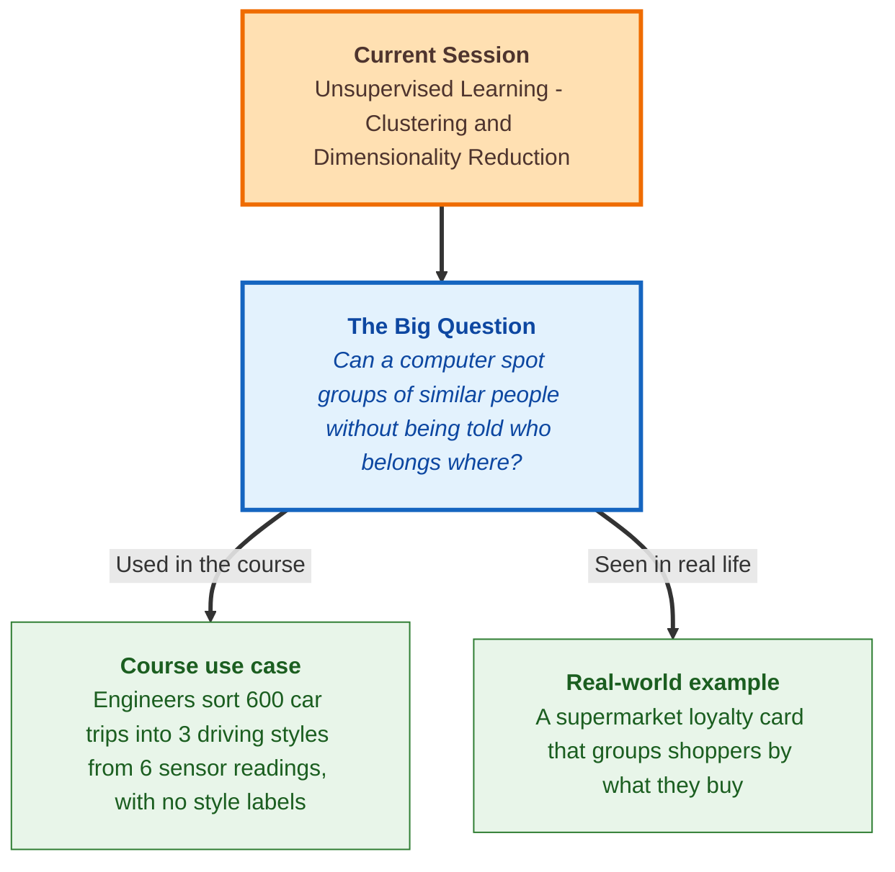

## <span style="color:#2F7DDE">Unsupervised Learning - Clustering and Dimensionality Reduction</span>

### <span style="color:#2F7DDE">Mental Map</span>



---

### <span style="color:#2F7DDE">What You'll Learn</span>

Have you ever wondered how a supermarket knows to send you coupons for the food you buy most?

By the end of this session, you will be able to:

- <span style="color:#D9660B">**Explain**</span> how a computer finds groups among 6 shoppers with no answers given.
- <span style="color:#D9660B">**Describe**</span> what each shopper group stands for, such as a "weekly family shop".
- <span style="color:#D9660B">**Use**</span> three lines of code to sort shoppers into 3 groups.
- <span style="color:#D9660B">**Determine**</span> the number of groups to make by finding where a falling curve bends.
- <span style="color:#D9660B">**Calculate**</span> how much detail survives when 5 spending columns become 2.
- <span style="color:#D9660B">**Judge**</span> the fewest new columns that keep 90 percent of the detail.

> <span style="color:#2F7DDE">**Topics you will meet:**</span> unsupervised learning, K-Means clustering, elbow method, Principal Component Analysis (PCA), explained variance and scree plot.
>
> Join the session to learn each of these in detail.

---

### <span style="color:#2F7DDE">Why You Are Learning This Topic</span>

You swipe a loyalty card at the supermarket till. A week later, the store sends you coupons for nappies and fresh fruit. Nobody sorted you by hand. Nobody told the computer which shoppers belong together. It found the groups on its own, from what people buy.

<span style="color:#D9660B">**Unsupervised learning**</span> means a computer finds groups and patterns in data that has no answer column.

In your course, you will use the same idea to sort car trips into driving styles.

> <span style="color:#2F7DDE">**Think about it:**</span> How could a computer decide that two shoppers are alike?

---

### <span style="color:#2F7DDE">The Loyalty Card Puzzle</span>

Here is what 6 shoppers spend in one week, in rupees.

| Shopper | Fruit and veg | Snacks | Baby items | Ready meals | Visits per week |
|:-------:|:-------------:|:------:|:----------:|:-----------:|:---------------:|
| Asha | 900 | 150 | 1200 | 100 | 2 |
| Ravi | 200 | 700 | 0 | 900 | 5 |
| Meena | 850 | 120 | 1100 | 150 | 2 |
| Imran | 250 | 650 | 0 | 800 | 6 |
| Kavya | 1100 | 100 | 0 | 200 | 1 |
| Tom | 1000 | 180 | 50 | 120 | 1 |

<span style="color:#D9660B">**What you want to happen:**</span>

- Put shoppers who buy alike into the same group.
- Pick a sensible number of groups.
- Draw all 6 shoppers on one flat chart.

Here is how it might start. You do not need to understand it yet.

```python
model = KMeans(n_clusters=3, n_init=10, random_state=0)
groups = model.fit_predict(shoppers)
print(groups)
```

> <span style="color:#D9660B">**Wonder about this:**</span>
>
> - How can a chart with only two sides show 5 columns at once?
> - What would the store lose if it squeezed 5 columns into 2?

---

### <span style="color:#2F7DDE">Think It Through</span>

There is no wrong first try. Keep your guesses for the session.

**1. Which shoppers in the table would you put together, and why?**
Hint: Look first at who spends on baby items.

**2. Six groups for 6 shoppers fit perfectly. Why would the store not want that?**
Hint: What could the store do with one group per person?

**3. Snacks and visits per week rise and fall together. Could one number stand in for both?**
Hint: If you know one of them, how well can you guess the other?

---

### <span style="color:#2F7DDE">One Question to Carry Into the Session</span>

> <span style="color:#2F7DDE">**How can a computer find groups in data when nobody gives it the answers?**</span>
>
> And how do you know you have the right number of groups?
