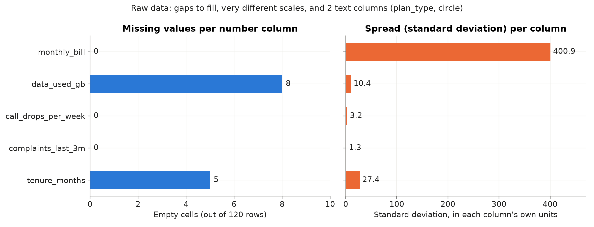
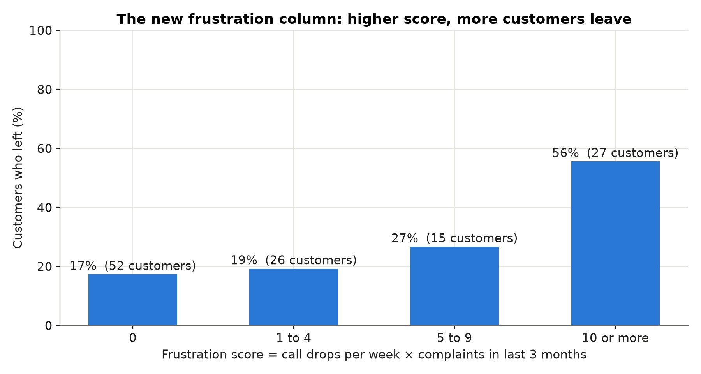
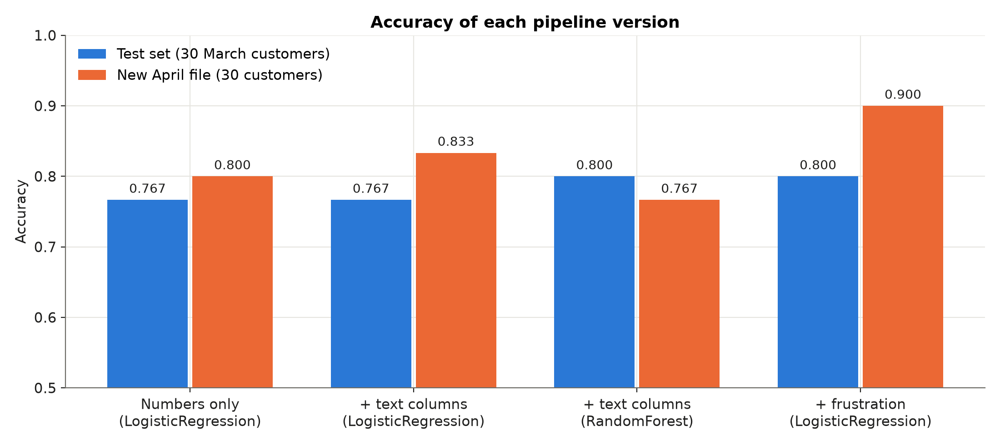
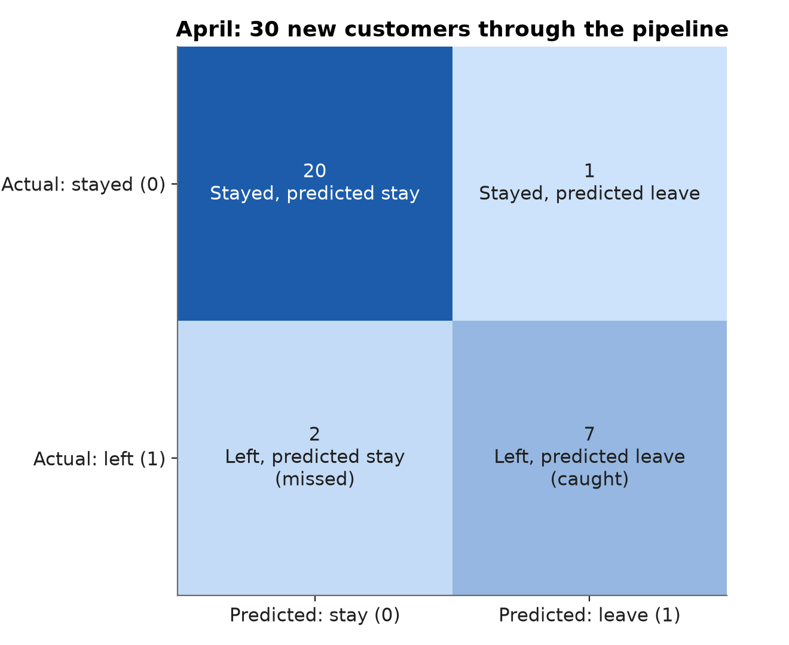
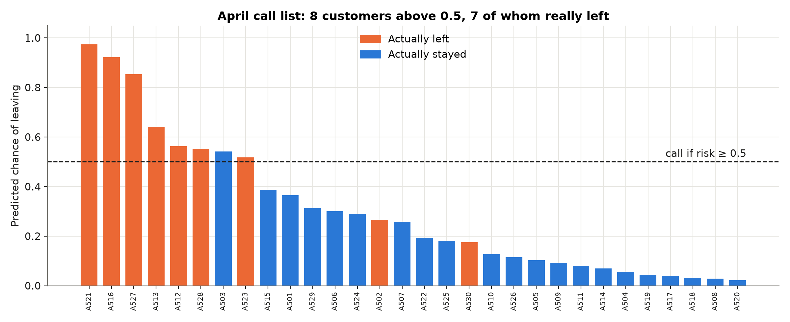

# <font color='#1d4ed8'>Lecture Script: Building a Complete ML Pipeline</font>

---

## <font color='blue'>Agenda</font>

The lecture runs as four topics. Each topic ends with a quiz.

| Topic | What we do | Learning objectives covered | Minutes |
|:-:|:--|:--|:-:|
| 1 | Walk the road from raw data to a prediction by hand, and watch it break on a new file | Understand what an end-to-end ML pipeline looks like from raw data to final prediction | 20 |
| 2 | Chain filling, encoding, scaling and the model into one Pipeline | use Scikit-learn Pipelines to chain preprocessing and model training into one reusable workflow in Google Colab | 35 |
| 3 | Add a home-made feature step and check it reaches the model | Add a custom feature-creation step to your Scikit-learn Pipeline using FunctionTransformer in Google Colab - for example, a step that multiplies two existing columns together before training; run the pipeline and confirm the new feature is being created and passed to the model correctly before prediction | 25 |
| 4 | Run the finished pipeline on April's new customers and read the results | run the pipeline on a new dataset and interpret the evaluation results | 30 |
| — | Closing: Outcome & Summary | | 10 |
| | **Total** | | **120** |

> <font color="red">**🎯 Instructor Note**</font> Pace: keep Topic 1 quick (learners know every preprocessing tool already); spend the most time building the Pipeline (Topic 2) and reading the April results (Topic 4).

---

## <font color='blue'>Scenario</font>

An Airtel-style mobile network wants to call customers who are about to switch to another network, before they leave. The retention team works on a monthly rhythm:

- **January to March:** 120 customers were watched. For each one we know the plan, the circle (region), the bill, data use, call drops, complaints, months with the network, and whether they **left**.
- **1 April:** a fresh file of 30 customers arrives. Nobody knows yet who will leave.
- **By 5 April:** the team must hand the call centre a list of customers to phone.
- **30 April:** the month ends and we learn who really left, so we can check the list.

The model has to be built once on the March data and then used on every new monthly file.

> <font color="red">**🎯 Instructor Note**</font> The company is only the setting; `telecom_customers.csv` (120 rows) and `april_customers.csv` (30 rows) are invented for teaching. Ask learners to upload both files to Colab before Topic 1 (outputs below came from scikit-learn 1.9.1).

---

## <font color='blue'>Problem Statement</font>

Last year an analyst built a churn model in a notebook. Cleaning was done in separate cells: fill the gaps, turn text into numbers, scale, then train. When the April file came, they ran the same cells again on it. The notebook crashed, because April had customers from a new region. They patched it in a hurry, and the fill and scale cells quietly re-learned their numbers from April instead of March. The call list reached the call centre a week late, and several customers on it had already moved to another network.

> <font color='purple'>**How do we package every cleaning stage and the model into one object that learns once from the March data, and then gives a call list we can trust for any new month's file?**</font>

> <font color="red">**🎯 Instructor Note**</font> Poll: "When April's file arrives, what should we re-fit on April's data: A) nothing, only predict, B) only the scaler, C) only the model, D) everything?" Give learners 30 seconds to respond in chat. Reveal the answer in the Closing.

---

## <font color='blue'>What We Will Use</font>

Everything runs in Google Colab with Pandas and Scikit-learn; charts use Matplotlib.

| Topic | Tools | In one line |
|:-:|:--|:--|
| 1 | `train_test_split`, `fillna`, `pd.get_dummies`, `StandardScaler`, `LogisticRegression` | The hand-made route from raw table to model |
| 2 | `Pipeline`, `SimpleImputer`, `ColumnTransformer`, `OneHotEncoder` | Chain every preparation stage and the model into one object |
| 3 | `FunctionTransformer` | Turn your own Python function into a pipeline stage |
| 4 | `predict`, `score`, `confusion_matrix`, `classification_report`, `predict_proba` | Use the pipeline on a new file and judge the results |

---

## <font color='blue'>How: Walking Through One Month of Churn Calls</font>


---

## <font color='blue'>Topic 1: From Raw Data to a Prediction</font> `20 min`

> <font color='purple'>**You already know every piece: cleaning, encoding, scaling, splitting, training, scoring. What does it look like when we line them all up on one real table?**</font>

In the preprocessing session you filled missing values, encoded text categories as numbers and scaled numeric columns. Since then you trained logistic regression, decision trees and random forests, always with `train_test_split` first and `fit`, `predict` and `score` after. Last session you used `StandardScaler` before K-Means. Today we join all of these into one road.

### <font color='green'>Example: Look at the raw March table</font>

> <font color='purple'>**Is this table ready to go straight into `LogisticRegression().fit()`?**</font>

**Predict before running: What will happen?**

> <font color="red">**🎯 Instructor Note**</font> Expected: 120 rows, 9 columns, gaps in two columns and two text columns. A common wrong guess is "yes, just fit it"; the gaps and text would stop the model.

```python
import pandas as pd
df = pd.read_csv("telecom_customers.csv")
print(df.shape)
print(df.head(3).T)
print(df.isna().sum().loc[["data_used_gb", "tenure_months"]])
print(round(df["left"].mean(), 3))
```

**Output**

```
(120, 9)
                              0         1           2
customer_id                A001      A002        A003
plan_type               Prepaid  Postpaid     Prepaid
circle               Tamil Nadu     Delhi  Tamil Nadu
monthly_bill                259      1439         259
data_used_gb               59.9      26.6         NaN
call_drops_per_week           5         8           3
complaints_last_3m            2         0           1
tenure_months              45.0      14.0        23.0
left                          0         0           0
data_used_gb     8
tenure_months    5
dtype: int64
0.275
```

#### <font color='#c2410c'>Code Explanation</font>

- **Lines 1–2** Load the March table, as in the Pandas sessions.
- **Line 3** 120 customers and 9 columns: an ID, 7 features and the label `left`.
- **Line 4** `.T` turns the first 3 rows on their side so every column fits on screen. Customer A003 has no value for data used.
- **Line 5** 8 customers have no `data_used_gb` and 5 have no `tenure_months`.
- **Line 6** 27.5% of customers left (33 of 120). This is the label the model will learn.

<p align="center"></p>

> <font color='green'>**Result**</font> The raw table has three problems before any model can learn: gaps (13 empty cells), text columns (`plan_type`, `circle`) and very different scales (bill spread ₹400.9 against complaints spread 1.3).

#### <font color='#c2410c'>Logic Explanation</font>

An **end-to-end ML pipeline** is the full road a row travels, from the raw file to a prediction someone can act on. Every row must travel the same road, in the same order, with the same learned numbers.


The three blue stages are **preprocessing**. Each one *learns* something from the training data: the median to fill with, the list of categories, the mean and standard deviation for scaling. Those learned numbers must be reused, unchanged, on every new row.

### <font color='green'>Extending it: Build the road by hand on the March data</font>

> <font color='purple'>**If we do each stage in its own line, as we have so far, what do we end up with?**</font>

> <font color="red">**🎯 Instructor Note**</font> Ask: "How many columns will the model see after encoding?" Expected: 11 (5 numbers, 2 plan columns, 4 circle columns).

```python
from sklearn.model_selection import train_test_split
from sklearn.preprocessing import StandardScaler
from sklearn.linear_model import LogisticRegression
X, y = df.drop(columns=["customer_id", "left"]), df["left"]
X_train, X_test, y_train, y_test = train_test_split(X, y, test_size=0.25, random_state=42, stratify=y)
manual = pd.get_dummies(X_train.fillna(X_train.median(numeric_only=True)))
scaler = StandardScaler().fit(manual)
model = LogisticRegression().fit(scaler.transform(manual), y_train)
print(X_train.shape, X_test.shape)
print(list(manual.columns))
```

**Output**

```
(90, 7) (30, 7)
['monthly_bill', 'data_used_gb', 'call_drops_per_week', 'complaints_last_3m', 'tenure_months', 'plan_type_Postpaid', 'plan_type_Prepaid', 'circle_Delhi', 'circle_Karnataka', 'circle_Mumbai', 'circle_Tamil Nadu']
```

#### <font color='#c2410c'>Code Explanation</font>

- **Line 4** Features are everything except the ID and the label.
- **Line 5** Split 90 rows for training and 30 for testing. `stratify=y` keeps the same 27.5% share of leavers in both parts.
- **Line 6** Fill each gap with the training median, then `get_dummies` turns each text column into one 0/1 column per category.
- **Line 7** The scaler learns each column's mean and standard deviation from the training rows.
- **Line 8** Train the model on the scaled training rows.
- **Lines 9–10** The model now expects exactly these 11 columns, in this order.

> <font color='green'>**Result**</font> It works, but the road lives in four separate objects and lines: the medians, the dummy columns, `scaler` and `model`. Nothing ties them together.

### <font color='green'>Extending it: Send April's file down the same road</font>

> <font color='purple'>**April's file has the same 7 features. Can we repeat those lines on it and predict?**</font>

> <font color="red">**🎯 Instructor Note**</font> Poll first: "Will it run?" Most learners say yes. It fails, because April has a fifth circle, Punjab.

```python
april = pd.read_csv("april_customers.csv")
new = april.drop(columns=["customer_id", "left"])
new = pd.get_dummies(new.fillna(new.median(numeric_only=True)))
print(new.shape[1], "columns:", [c for c in new.columns if c not in manual.columns])
model.predict(scaler.transform(new))
```

**Output**

```
12 columns: ['circle_Punjab']
ValueError: The feature names should match those that were passed during fit.
Feature names unseen at fit time:
- circle_Punjab
```

#### <font color='#c2410c'>Code Explanation</font>

- **Line 3** The same fill-and-encode line, now on April. It fills gaps with **April's** medians (15.1 GB and 46 months), not the training medians (14.6 GB and 48 months). That is a quiet mistake: no error, just different numbers.
- **Line 4** `get_dummies` sees a category it never saw in March and makes a twelfth column, `circle_Punjab`.
- **Line 5** The scaler was fitted on 11 columns, so it refuses the 12-column table.

> <font color='green'>**Result**</font> The hand-made road breaks on the first new file. It has one loud error (a new column) and one silent one (fill numbers re-learned from April). This is exactly what went wrong in the Problem Statement.

### <font color='purple'>Quiz 1</font>

**Question:** In the hand-made route, why did April's file fail when it reached the scaler?

**Options:**
- A) April's file has missing values, and the scaler cannot handle gaps
- B) Encoding April on its own created a new `circle_Punjab` column the scaler and model never saw
- C) `train_test_split` was not run on April's file
- D) April's file has fewer rows than the training data

**Correct Answer:** B

**Explanation:**
- **A)** Wrong: line 3 filled April's gaps before scaling; the error message names a column, not a gap.
- **B)** Correct: `get_dummies` builds columns from whatever categories it sees, so April got 12 columns instead of 11.
- **C)** Wrong: new data is never split; we only predict on it.
- **D)** Wrong: the scaler works on any number of rows; it checks the columns.

---

## <font color='blue'>Topic 2: One Pipeline Object</font> `35 min`

> <font color='purple'>**The hand-made road broke because its stages were loose. How do we tie them into one object that remembers everything it learned from March?**</font>

### <font color='green'>Example: A pipeline for the number columns</font>

> <font color='purple'>**Can one object fill the gaps, scale and train, all with a single `fit`?**</font>

A **`Pipeline`** is a list of named stages. Every stage except the last prepares the data; the last stage is the model.

- `pipe.fit(X, y)` runs each preparation stage's `fit_transform` in order, then fits the model on the result.
- `pipe.predict(X_new)` runs each stage's `transform` only, with the numbers it learned during `fit`, then predicts.

**Predict before running: What will happen?**

> <font color="red">**🎯 Instructor Note**</font> Expected: one accuracy score and the 5 medians the imputer learned. Point out that 14.6 and 48 are the training medians from Topic 1.

```python
from sklearn.pipeline import Pipeline
from sklearn.impute import SimpleImputer
num_cols = ["monthly_bill", "data_used_gb", "call_drops_per_week", "complaints_last_3m", "tenure_months"]
num_pipe = Pipeline([
    ("fill", SimpleImputer(strategy="median")),
    ("scale", StandardScaler()),
    ("model", LogisticRegression())])
num_pipe.fit(X_train[num_cols], y_train)
print(round(num_pipe.score(X_test[num_cols], y_test), 3))
print(num_pipe.named_steps["fill"].statistics_)
```

**Output**

```
0.767
[479.   14.6   4.    1.   48. ]
```

#### <font color='#c2410c'>Code Explanation</font>

- **Line 2** `SimpleImputer` is Scikit-learn's version of `fillna`. With `strategy="median"` it learns each column's median during `fit`.
- **Line 3** The 5 number columns.
- **Lines 4–7** Three named stages: fill, scale, model. The names are ours to choose.
- **Line 8** One `fit` call does all three, on training rows only.
- **Line 9** One `score` call fills, scales and predicts the 30 test rows, then reports accuracy: 23 of 30 correct.
- **Line 10** `named_steps` lets us look inside a stage. These medians (₹479, 14.6 GB, 4 drops, 1 complaint, 48 months) are stored and reused for every future row.

> <font color='green'>**Result**</font> One object now holds the fill numbers, the scaling numbers and the model. Test accuracy is 0.767, using numbers only.

### <font color='green'>Extending it: Add the text columns with ColumnTransformer</font>

> <font color='purple'>**`plan_type` and `circle` need encoding, not scaling. How does one pipeline treat different columns differently?**</font>

> <font color="red">**🎯 Instructor Note**</font> Ask: "What should happen to Punjab when we predict April?" Let learners guess; `handle_unknown="ignore"` is the answer, and Topic 4 tests it.

A **`ColumnTransformer`** sends each group of columns down its own small pipeline and glues the results side by side. `OneHotEncoder` is Scikit-learn's version of `get_dummies`; it learns the list of categories during `fit` and keeps it.

```python
from sklearn.compose import ColumnTransformer
from sklearn.preprocessing import OneHotEncoder
cat_cols = ["plan_type", "circle"]
prep = ColumnTransformer([
    ("num", Pipeline([("fill", SimpleImputer(strategy="median")), ("scale", StandardScaler())]), num_cols),
    ("cat", OneHotEncoder(handle_unknown="ignore"), cat_cols)])
pipe = Pipeline([("prep", prep), ("model", LogisticRegression())])
pipe.fit(X_train, y_train)
print(round(pipe.score(X_test, y_test), 3))
print(pipe.named_steps["prep"].get_feature_names_out())
```

**Output**

```
0.767
['num__monthly_bill' 'num__data_used_gb' 'num__call_drops_per_week'
 'num__complaints_last_3m' 'num__tenure_months' 'cat__plan_type_Postpaid'
 'cat__plan_type_Prepaid' 'cat__circle_Delhi' 'cat__circle_Karnataka'
 'cat__circle_Mumbai' 'cat__circle_Tamil Nadu']
```

#### <font color='#c2410c'>Code Explanation</font>

- **Line 5** Number columns go through fill then scale.
- **Line 6** Text columns go through `OneHotEncoder`. `handle_unknown="ignore"` means a category never seen in training (such as a new circle) becomes all zeros instead of an error.
- **Line 7** The full pipeline: preparation, then model.
- **Line 8** Note we now pass the whole `X_train`, text and gaps included. No cleaning by hand.
- **Line 9** Test accuracy, using all 7 features.
- **Line 10** The 11 columns the model sees, the same 11 as the hand-made route, each tagged with the branch it came from.

> <font color='green'>**Result**</font> One `fit` on the raw training table now does every preparation stage and trains the model. Test accuracy stays 0.767 (one more feature group does not always change the score), but the pipeline accepts raw data directly.

> <font color='#b45309'>**Common mistake**</font> Scaling or filling the whole table *before* `train_test_split`. The test rows would then help choose the medians and means, so the test score would look better than it should. Inside a pipeline, `fit` only ever sees `X_train`.

### <font color='green'>Extending it: Swap the model, keep the preparation</font>

> <font color='purple'>**What if the team wants to try a random forest instead? How much do we have to rewrite?**</font>

> <font color="red">**🎯 Instructor Note**</font> Stress the "reusable" part of the objective: only the last stage changes.

```python
from sklearn.base import clone
from sklearn.ensemble import RandomForestClassifier
rf_pipe = Pipeline([("prep", clone(prep)), ("model", RandomForestClassifier(random_state=42))])
rf_pipe.fit(X_train, y_train)
print(round(rf_pipe.score(X_test, y_test), 3))
print(round(pipe.score(X_test, y_test), 3))
```

**Output**

```
0.8
0.767
```

#### <font color='#c2410c'>Code Explanation</font>

- **Line 1** `clone` makes a fresh, unfitted copy of `prep`, so the two pipelines do not share one object.
- **Line 3** Same preparation, new last stage: the random forest from the Random Forests session.
- **Lines 4–6** Fit and score it, and print the logistic regression pipeline's score again to compare.

> <font color='green'>**Result**</font> Changing the model took one line. On these 30 test customers the forest scores 0.8 against 0.767, a difference of one customer.

### <font color='purple'>Quiz 2</font>

**Question:** You call `pipe.fit(X_train, y_train)` and then `pipe.score(X_test, y_test)`. What does the `SimpleImputer` inside do during `score`?

**Options:**
- A) It learns new medians from `X_test` and fills the test gaps with them
- B) It learns medians from `X_train` and `X_test` combined
- C) It is skipped, because filling only happens during training
- D) It fills the test gaps with the medians it learned from `X_train` during `fit`

**Correct Answer:** D

**Explanation:**
- **A)** Wrong: that is the hand-made mistake from Topic 1; inside a pipeline, `score` only calls `transform`.
- **B)** Wrong: test rows never take part in `fit`.
- **C)** Wrong: every stage runs on every call; test rows have gaps too and must be filled.
- **D)** Correct: `fit` learns the medians once (₹479, 14.6 GB, …) and every later call reuses them.

---

## <font color='blue'>Topic 3: Adding Our Own Feature Step</font> `25 min`

> <font color='purple'>**The retention team says customers leave when calls keep dropping *and* their complaints go unanswered. Can the pipeline build that signal itself?**</font>

### <font color='green'>Example: Turn a Python function into a pipeline stage</font>

> <font color='purple'>**How do we make a "frustration" column, call drops × complaints, so that it is created for every row automatically?**</font>

`FunctionTransformer` wraps any function that takes a table and returns a table, so it can sit inside a pipeline like any other stage.

$$\boxed{\text{frustration} = \text{call drops per week} \times \text{complaints in last 3 months}}$$

**Predict before running: What will happen?**

> <font color="red">**🎯 Instructor Note**</font> Expected: frustration is 0 whenever complaints are 0, even with 9 drops. Some learners expect 9; multiplying by 0 gives 0.

```python
from sklearn.preprocessing import FunctionTransformer
def add_frustration(X):
    X = X.copy()
    X["frustration"] = X["call_drops_per_week"] * X["complaints_last_3m"]
    return X
adder = FunctionTransformer(add_frustration)
print(adder.fit_transform(X_train.head(4))[["call_drops_per_week", "complaints_last_3m", "frustration"]])
```

**Output**

```
     call_drops_per_week  complaints_last_3m  frustration
15                     9                   0            0
89                     2                   1            2
57                     3                   1            3
111                    3                   0            0
```

#### <font color='#c2410c'>Code Explanation</font>

- **Lines 2–5** A normal Python function, as in the functions session. `X.copy()` makes sure the original table is not changed.
- **Line 6** Wrap the function as a stage. It learns nothing during `fit`; it only applies the rule.
- **Line 7** Try it on 4 training rows and show the two inputs beside the new column.

> <font color='green'>**Result**</font> The new column is created correctly: 9 × 0 = 0, 2 × 1 = 2, 3 × 1 = 3, 3 × 0 = 0.

<p align="center"></p>

### <font color='green'>Extending it: Put the step inside the pipeline</font>

> <font color='purple'>**The function works on its own. Does the new column reach the model when we fit the whole pipeline?**</font>

> <font color="red">**🎯 Instructor Note**</font> Point out `num_cols + ["frustration"]`: the ColumnTransformer only passes on columns it is told about. Forgetting this is the most common slip.

```python
prep_fe = ColumnTransformer([
    ("num", Pipeline([("fill", SimpleImputer(strategy="median")), ("scale", StandardScaler())]), num_cols + ["frustration"]),
    ("cat", OneHotEncoder(handle_unknown="ignore"), cat_cols)])
fe_pipe = Pipeline([("add", adder), ("prep", prep_fe), ("model", LogisticRegression())])
fe_pipe.fit(X_train, y_train)
print(round(fe_pipe.score(X_test, y_test), 3))
print(fe_pipe.named_steps["prep"].get_feature_names_out()[:6])
```

**Output**

```
0.8
['num__monthly_bill' 'num__data_used_gb' 'num__call_drops_per_week'
 'num__complaints_last_3m' 'num__tenure_months' 'num__frustration']
```

#### <font color='#c2410c'>Code Explanation</font>

- **Lines 1–3** The same preparation as Topic 2, except the number branch now also takes `frustration`, so it gets filled and scaled too.
- **Line 4** Three stages: add the feature, prepare, model. Order matters: the column must exist before the ColumnTransformer looks for it.
- **Line 5** Fit on the raw `X_train`. We never add the column by hand.
- **Line 6** Test accuracy rises from 0.767 to 0.8.
- **Line 7** The sixth column going into the model is `num__frustration`. The feature was created *and* passed on.

### <font color='green'>Extending it: Confirm the model is using it</font>

> <font color='purple'>**The column reaches the model. Does the model give it any weight?**</font>

> <font color="red">**🎯 Instructor Note**</font> All inputs are scaled, so the coefficient sizes can be compared. Read only the top and bottom rows.

```python
names = fe_pipe.named_steps["prep"].get_feature_names_out()
coefs = pd.Series(fe_pipe.named_steps["model"].coef_[0], index=names)
print(coefs.round(2).sort_values(ascending=False))
```

**Output**

```
num__frustration            1.24
cat__circle_Karnataka       0.51
num__call_drops_per_week    0.28
cat__plan_type_Prepaid      0.14
num__data_used_gb           0.07
cat__circle_Delhi           0.05
num__monthly_bill          -0.05
cat__circle_Tamil Nadu     -0.09
cat__plan_type_Postpaid    -0.14
num__complaints_last_3m    -0.16
cat__circle_Mumbai         -0.46
num__tenure_months         -1.12
dtype: float64
```

#### <font color='#c2410c'>Code Explanation</font>

- **Line 1** The names of the 12 columns the model received.
- **Line 2** `coef_[0]` holds one weight per column, as in the logistic regression session. We label each weight with its column name.
- **Line 3** Sort from the biggest push towards "left" to the biggest push towards "stayed".

<p align="center"></p>

> <font color='green'>**Result**</font> Frustration has the largest positive weight (1.24): more dropped calls with more complaints pushes the prediction towards "will leave". Long tenure (−1.12) pushes the other way. The new feature is not just present; it is the model's strongest signal.

### <font color='purple'>Quiz 3</font>

**Question:** A customer has 6 call drops per week and 3 complaints. What value of `frustration` does the `add` stage create for this row, before scaling?

**Options:**
- A) 18
- B) 9
- C) 2
- D) None, because the ColumnTransformer drops columns that were not in the original table

**Correct Answer:** A

**Explanation:**
- **A)** Correct: the function multiplies the two columns, 6 × 3 = 18.
- **B)** Wrong: 9 is 6 + 3; the function multiplies, it does not add.
- **C)** Wrong: 2 is 6 ÷ 3; there is no division in the function.
- **D)** Wrong: we listed `"frustration"` in the number branch, so it is passed on and scaled; `get_feature_names_out` showed it.

---

## <font color='blue'>Topic 4: Running the Pipeline on April's Customers</font> `30 min`

> <font color='purple'>**The hand-made road crashed on April's file. What does the finished pipeline do with the same 30 raw rows?**</font>

### <font color='green'>Example: Predict and score the new file</font>

> <font color='purple'>**Can one line turn April's raw rows, gaps and Punjab included, into predictions?**</font>

**Predict before running: What will happen?**

> <font color="red">**🎯 Instructor Note**</font> Expected: no error, 30 predictions of 0 or 1. Ask for a guess at accuracy; most say "about 0.8, like the test set".

```python
X_new, y_new = april.drop(columns=["customer_id", "left"]), april["left"]
pred = fe_pipe.predict(X_new)
print(X_new.shape)
print(pred[:10])
print(round(fe_pipe.score(X_new, y_new), 3))
```

**Output**

```
(30, 7)
[0 0 1 0 0 0 0 0 0 0]
0.9
```

#### <font color='#c2410c'>Code Explanation</font>

- **Line 1** April's 7 raw features, and the true `left` column we learned on 30 April.
- **Line 2** One call: add frustration, fill with **March** medians, scale with **March** means, encode with **March** categories, predict. Nothing is re-fitted.
- **Line 4** The first 10 predictions; the third customer is predicted to leave.
- **Line 5** 27 of 30 April customers predicted correctly.

> <font color='green'>**Result**</font> The pipeline runs on the new file without a single cleaning line, and gets 0.9 accuracy on customers it never saw.

### <font color='green'>Extending it: Read the April results properly</font>

> <font color='purple'>**0.9 sounds good. But the team cares about one thing: of the customers who really left, how many were on our list?**</font>

> <font color="red">**🎯 Instructor Note**</font> Remind learners that 21 of 30 stayed, so predicting "stay" for everyone would already score 0.7. Accuracy alone is not enough.

```python
from sklearn.metrics import confusion_matrix, classification_report
print(confusion_matrix(y_new, pred))
print(classification_report(y_new, pred))
```

**Output**

```
[[20  1]
 [ 2  7]]
              precision    recall  f1-score   support

           0       0.91      0.95      0.93        21
           1       0.88      0.78      0.82         9

    accuracy                           0.90        30
   macro avg       0.89      0.87      0.88        30
weighted avg       0.90      0.90      0.90        30
```

#### <font color='#c2410c'>Code Explanation</font>

- **Line 2** Rows are the truth (stayed, left), columns are the prediction, as in the classification metrics session.
- **Line 3** Precision, recall and F1 for each class. Row `1` is the class the team cares about: customers who left.

<p align="center"></p>

#### <font color='#c2410c'>Logic Explanation</font>

| Number | Reads as | What it means for the call centre |
|:--|:--|:--|
| Recall for "left" = 0.78 | 7 of the 9 customers who left were predicted to leave | We would have phoned 7 of 9 leavers; 2 slipped through |
| Precision for "left" = 0.88 | 7 of the 8 "will leave" predictions were right | Only 1 call goes to a customer who was going to stay anyway |
| Accuracy = 0.90 | 27 of 30 correct | Looks strong, but "everyone stays" would already get 0.70 |
| Test accuracy was 0.80, April is 0.90 | 30 rows each, so one customer moves accuracy by 0.033 | The model did not "get better"; small files swing. Judge it over several months |

> <font color='green'>**Result**</font> On new customers, the pipeline caught 7 of 9 leavers and wasted 1 call. The chart in Topic 3 also shows the random forest, which won on the test set, dropping to 0.767 on April: one 30-row test is a weak reason to pick a model.

### <font color='green'>Extending it: Why did Punjab not break anything?</font>

> <font color='purple'>**Two April customers are from Punjab, a circle the pipeline never saw. What if we had left out `handle_unknown="ignore"`?**</font>

> <font color="red">**🎯 Instructor Note**</font> Poll: "Crash or no crash?" Expected: crash, with a clear message naming Punjab.

```python
strict = clone(fe_pipe).set_params(prep__cat=OneHotEncoder())
strict.fit(X_train, y_train)
strict.predict(X_new)
```

**Output**

```
ValueError: Found unknown categories ['Punjab'] in column 1 during transform
```

#### <font color='#c2410c'>Code Explanation</font>

- **Line 1** Copy the finished pipeline and swap only the encoder for one with default settings. `prep__cat` means "the `cat` branch inside the `prep` stage".
- **Lines 2–3** Fit on March, then predict April.

> <font color='green'>**Result**</font> Without `handle_unknown="ignore"`, the pipeline stops on the new circle, just as the hand-made route did. With it, the two Punjab customers (A501 and A515) get zeros in every circle column and are still scored using their other 6 features; both were predicted to stay, and both did.

### <font color='purple'>Quiz 4</font>

**Question:** The April confusion matrix is `[[20, 1], [2, 7]]`, where the second row is customers who actually left. Which statement is correct?

**Options:**
- A) Accuracy is 0.9, so the model caught 90% of the customers who left
- B) Precision for "left" is 0.88, so 88% of the customers who left were caught
- C) Of the 9 customers who left, 7 were predicted to leave, and 7 of the 8 "will leave" predictions were right
- D) April accuracy (0.9) is higher than test accuracy (0.8), so the model improved after training

**Correct Answer:** C

**Explanation:**
- **A)** Wrong: accuracy counts both classes; the share of leavers caught is recall, 7 ÷ 9 = 0.78.
- **B)** Wrong: that describes recall; precision is about how many "will leave" calls were right.
- **C)** Correct: recall = 7 ÷ 9 = 0.78 and precision = 7 ÷ 8 = 0.88.
- **D)** Wrong: the model does not change after `fit`; with only 30 rows, one customer moves accuracy by 0.033.

---

## <font color='blue'>Closing: Outcome & Summary</font> `10 min`

Back to the retention team: last year the hand-made notebook crashed on April's file, re-learned its numbers from April, and the call list came a week late.

> <font color='purple'>**1. Why did the old way fail?**</font>

Each stage lived in its own line and learned again whenever it ran. On a new file, encoding made an extra column and filling used April's own medians (Topic 1).

> <font color='purple'>**2. What replaces it?**</font>

One `Pipeline` that fills, encodes, scales and trains with a single `fit` on March data, and reuses every learned number for any later file (Topic 2). It also builds the frustration feature, the model's strongest signal, on every row automatically (Topic 3).

> <font color='purple'>**3. What does the call centre get on 1 April?**</font>

```python
april["risk"] = fe_pipe.predict_proba(X_new)[:, 1].round(2)
call_list = april[april["risk"] >= 0.5].sort_values("risk", ascending=False)
print(call_list[["customer_id", "circle", "risk", "left"]].to_string(index=False))
print(len(call_list), "to call;", call_list["left"].sum(), "of them actually left")
print(y_new.sum(), "left in total")
```

**Output**

```
customer_id     circle  risk  left
       A521     Mumbai  0.97     1
       A516 Tamil Nadu  0.92     1
       A527  Karnataka  0.85     1
       A513  Karnataka  0.64     1
       A512  Karnataka  0.56     1
       A528      Delhi  0.55     1
       A503  Karnataka  0.54     0
       A523     Mumbai  0.52     1
8 to call; 7 of them actually left
9 left in total
```

#### <font color='#c2410c'>Code Explanation</font>

- **Line 1** `predict_proba` from the logistic regression session gives each April customer's chance of leaving, straight from the raw rows (Topics 2 and 3).
- **Line 2** Keep customers at 0.5 or above, highest risk first. This is the call list.
- **Lines 3–5** On 30 April we check the list against who really left (Topic 4).

<p align="center"></p>

### <font color='green'>Outcome</font>

| | Hand-made cells | One pipeline |
|:--|:-:|:-:|
| Lines to re-run on a new file | 4 stages retyped | 1 (`fe_pipe.predict`) |
| Numbers re-learned from the new file | Medians and dummy columns | None |
| New circle (Punjab) | Crash | Handled (all zeros) |
| April accuracy | No result | 0.90 |
| April leavers on the call list | No list | 7 of 9 |

> <font color='green'>**Therefore,**</font> packaging every stage and the model into one pipeline, fitted once on March data, turns any new monthly file into a call list in one line, with no cleaning by hand. The catch: it still missed 2 of 9 leavers (A502 and A530, at 0.27 and 0.18), and 30 rows a month is too few to trust a single month's score.

> <font color="red">**🎯 Instructor Note**</font> Reveal the poll: A, nothing is re-fitted on April. We only call `predict`; every number the pipeline uses was learned from March.

### <font color='green'>Summary</font>

| Learning objective | Takeaway |
|:--|:--|
| What an end-to-end pipeline looks like | Raw file → fill gaps → encode text → scale → train → predict → evaluate; every row must take the same road with the same learned numbers. |
| Chain preprocessing and model with Pipelines | `Pipeline([("prep", ColumnTransformer(...)), ("model", ...)])`; one `fit` on `X_train`, and swapping the model changes one line. |
| Add a custom feature step | `FunctionTransformer(add_frustration)` as the first stage; list the new column in the ColumnTransformer and confirm it with `get_feature_names_out()`. |
| Run on a new dataset and interpret | `predict` and `score` on raw new rows; read recall and precision for the class you care about, compare with "everyone stays", and remember small files swing. |
| **Practical value** | Any model you build can now be handed a fresh file (next month's customers, today's trips, this week's sensor readings) and give predictions in one line, without retyping a single cleaning step. |

---

# <font color='red'>Launch the Feedback Poll</font>

> <font color="red">**🎯 Instructor Note**</font> Reminder: launch the feedback poll now to collect learner feedback.
