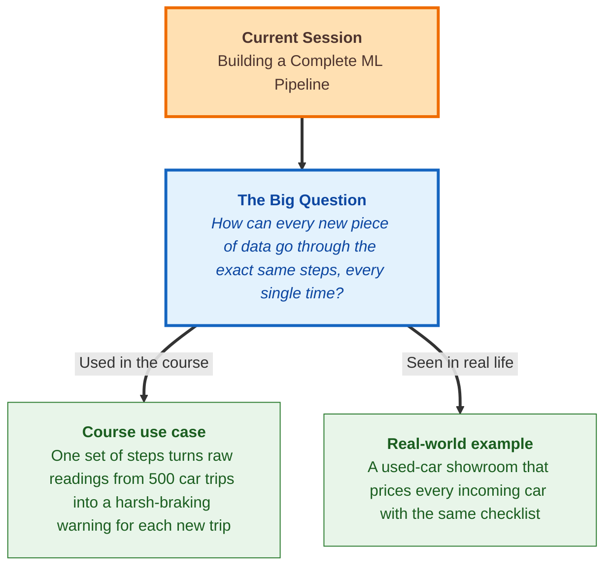

## <span style="color:#2F7DDE">Building a Complete ML Pipeline</span>

### <span style="color:#2F7DDE">Mental Map</span>



---

### <span style="color:#2F7DDE">What You'll Learn</span>

Have you ever wondered how a used-car showroom quotes a fair price for a car it saw ten minutes ago?

By the end of this session, you will be able to:

- <span style="color:#D9660B">**List**</span> the 4 checks every car goes through before it gets a price.
- <span style="color:#D9660B">**Describe**</span> the full road one row of data travels, from a raw table to a final price.
- <span style="color:#D9660B">**Use**</span> one object to fill blanks, turn fuel type into numbers and learn prices, in one go.
- <span style="color:#D9660B">**Examine**</span> how close the prices for 4 new arrivals come to their real sale prices.
- <span style="color:#D9660B">**Build**</span> a new "km per year" column from two existing columns, inside the same set of steps.

> <span style="color:#2F7DDE">**Topics you will meet:**</span> end-to-end ML pipeline, Scikit-learn Pipeline, ColumnTransformer, FunctionTransformer and evaluating a pipeline on new data.
>
> Join the session to learn each of these in detail.

---

### <span style="color:#2F7DDE">Why You Are Learning This Topic</span>

A family brings their old hatchback to a used-car showroom. The staff open the checklist they use for every car. They note age, kilometres and fuel, and fill any blank in the service record. Then they read the price from last year's sales. The next car gets the exact same checklist, in the exact same order.

A <span style="color:#D9660B">**pipeline**</span> means a fixed set of steps that every new row of data passes through, in the same order.

In your course, you will wrap cleaning steps and a model into one reusable pipeline.

> <span style="color:#2F7DDE">**Think about it:**</span> What would go wrong if each salesperson followed the checklist in a different order?

---

### <span style="color:#2F7DDE">The Showroom Puzzle</span>

Here are 4 cars that arrive at the showroom tomorrow.

| Car | Age (years) | Km driven | Fuel | Service book |
|:---:|:-----------:|:---------:|:----:|:------------:|
| Swift | 6 | 72,000 | Petrol | Yes |
| City | 8 | 96,000 | Diesel | Blank |
| Nexon | 3 | 30,000 | Petrol | Yes |
| WagonR | 5 | 60,000 | CNG | No |

Last year's records hold only petrol and diesel cars.

<span style="color:#D9660B">**What you want to happen:**</span>

- Every car goes through the same checklist, with no step skipped.
- A blank or a new fuel type does not stop the pricing.
- The showroom can check its prices against sale prices later.

Here is how it might start. You do not need to understand it yet.

```python
pipe = Pipeline([("fill", SimpleImputer()), ("model", LinearRegression())])
pipe.fit(old_cars, old_prices)
print(pipe.predict(new_cars))
```

> <span style="color:#D9660B">**Wonder about this:**</span>
>
> - Should the blank for the City be filled using last year's cars or tomorrow's cars?
> - How would the showroom know whether its prices are close to the truth?

---

### <span style="color:#2F7DDE">Think It Through</span>

There is no wrong first try. Keep your guesses for the session.

**1. The City has a blank service book entry. What would you write there?**
Hint: Think about what most cars in last year's records had.

**2. The WagonR runs on CNG, and the checklist knows only petrol and diesel. What should happen?**
Hint: Should one unknown word stop the price for the whole car?

**3. Two cars are both 6 years old. One has 30,000 km and the other has 120,000 km. Which new number would tell the dealer the most?**
Hint: Try dividing one column by the other.

---

### <span style="color:#2F7DDE">One Question to Carry Into the Session</span>

> <span style="color:#2F7DDE">**How do you make sure tomorrow's data goes through exactly the same steps as last year's data?**</span>
>
> And how do you check the answers for brand-new data?
