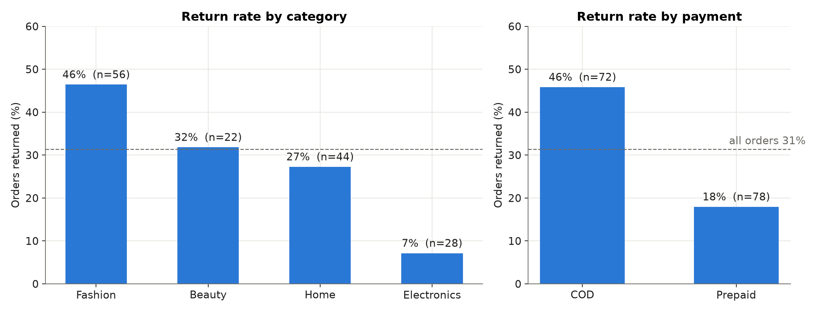
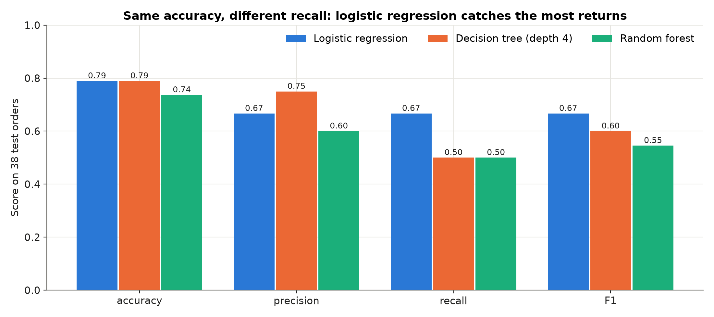
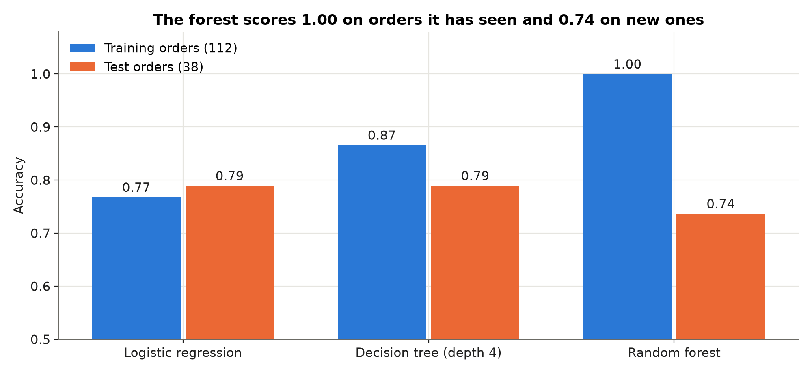
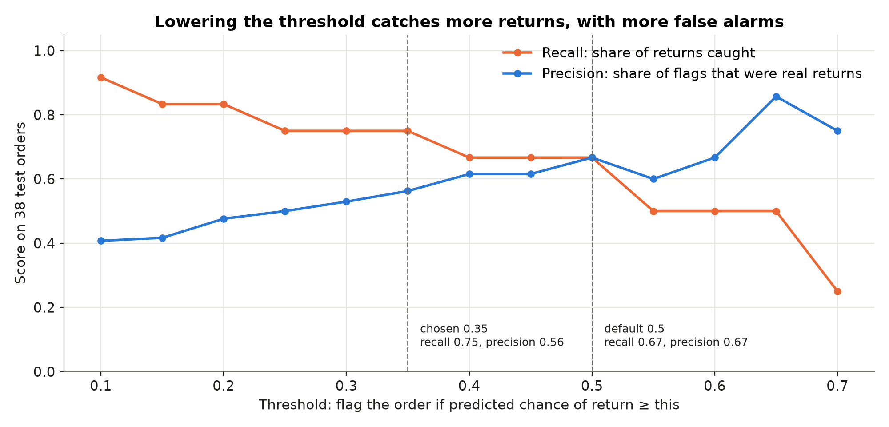
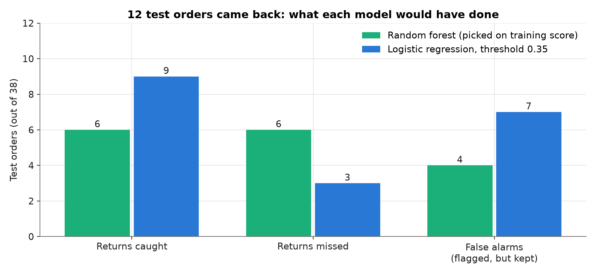

# <font color='#1d4ed8'>Lecture Script: Module Wrap-up: Hands-On Predictive Modelling Practice</font>

---

## <font color='blue'>Agenda</font>

The lecture runs as four topics. Each topic ends with a quiz.

| Topic | What we do | Learning objectives covered | Minutes |
|:-:|:--|:--|:-:|
| 1 | Frame the returns problem, split the orders and prepare the columns | Solve a complete prediction problem from start to finish using Python, Pandas, and Scikit-learn in Google Colab | 25 |
| 2 | Pick the metric first, then train and compare three models | choose an appropriate model, train it, and evaluate it using the right metrics | 35 |
| 3 | Find the chosen model's strength and weakness, and improve it | identify one clear strength and one clear weakness of your chosen model and suggest how it could be improved | 30 |
| 4 | Explain the result to someone who has never heard of machine learning | Write a plain-language summary of your model's results in two short paragraphs - covering the problem, the model chosen, the key metric, and one thing you would change; practise writing as if explaining to someone who has never heard of machine learning, because communicating results clearly is just as important as building the model | 20 |
| — | Closing: Outcome & Summary | | 10 |
| | **Total** | | **120** |

> <font color="red">**🎯 Instructor Note**</font> Pace: every tool today is from earlier sessions, so keep code walk-throughs short and spend the time on decisions: which metric (Topic 2) and which weakness to fix (Topic 3).

---

## <font color='blue'>Scenario</font>

A Flipkart-style shopping app loses money every time a parcel comes back. The operations team compares two ways an order can go:

| | Order kept | Order returned |
|:--|:--|:--|
| What happens | Courier delivers, customer keeps it | Courier delivers or tries to, parcel travels back to the warehouse |
| Cost to the app | Nothing extra | About ₹150 in two-way shipping |
| What the team could do first | Nothing | A ₹10 confirmation call before shipping, or ask the customer to pay online |

The team has 150 past orders with 7 details each and a column saying whether the order came back. They want a model that flags risky orders **before** they ship.

> <font color="red">**🎯 Instructor Note**</font> The company is only the setting; `orders.csv` (150 rows) and the ₹150 and ₹10 costs are invented for teaching. Ask learners to upload the file to Colab before Topic 1 (outputs below came from scikit-learn 1.9.1).

---

## <font color='blue'>Problem Statement</font>

A new analyst trained three models on the past orders. The random forest scored 100% on those orders, so it went live the next day. A fortnight later the warehouse was still full of returned parcels: the "perfect" model was missing about half of the returns. The analyst had checked the model on the same orders it had learned from, and had looked at only one number.

> <font color='purple'>**Starting from a raw table of 150 orders, how do we build, choose and judge a model that flags likely returns before they ship, and explain that choice to the operations team in plain words?**</font>

> <font color="red">**🎯 Instructor Note**</font> Poll: "Which model would you ship: A) random forest, it scored 100%, B) decision tree, C) logistic regression, D) cannot tell yet?" Give learners 30 seconds to respond in chat. Reveal the answer in the Closing.

---

## <font color='blue'>What We Will Use</font>

Nothing new today: every tool comes from earlier sessions, used together in Google Colab.

| Topic | Tools | In one line |
|:-:|:--|:--|
| 1 | `pd.read_csv`, `groupby`, `train_test_split`, `ColumnTransformer` | Understand the table, keep test orders aside, prepare every column |
| 2 | `Pipeline`, `LogisticRegression`, `DecisionTreeClassifier`, `RandomForestClassifier`, `precision_score`, `recall_score`, `f1_score` | Train three candidates and score them on the metric that matches the cost |
| 3 | `score` on train and test, `coef_`, `predict_proba` with a threshold | Spot overfitting, read what the model relies on, trade false alarms for caught returns |
| 4 | f-strings | Turn the numbers into sentences for a non-technical reader |

---

## <font color='blue'>How: Walking Through the Returns Problem</font>


---

## <font color='blue'>Topic 1: Frame the Problem and Prepare the Data</font> `25 min`

> <font color='purple'>**Before any model: what exactly are we predicting, from what, and how do we keep an honest test aside?**</font>

This session uses everything in the module in one go. You met features and target labels and `train_test_split` when you first met machine learning. You filled gaps, encoded categories and scaled numbers in the preprocessing session. You trained logistic regression, decision trees and random forests, and scored them with precision, recall and F1. Last session you chained all of it into one Pipeline.

### <font color='green'>Example: Read the table and name the target</font>

> <font color='purple'>**Which column is the label, how often does it happen, and which details look linked to it?**</font>

**Predict before running: What will happen?**

> <font color="red">**🎯 Instructor Note**</font> Expected: `returned` is the label, about 1 order in 3 comes back. Ask learners to guess which payment type returns more before running.

```python
import pandas as pd
df = pd.read_csv("orders.csv")
print(df.shape)
print(df.head(3).T)
print(df["returned"].value_counts())
print(df["delivery_days"].isna().sum())
for col in ["category", "payment"]:
    print(df.groupby(col)["returned"].mean().round(2))
```

**Output**

```
(150, 9)
                    0       1        2
order_id       OD1001  OD1002   OD1003
category         Home    Home     Home
order_value      2389    2079      929
payment           COD     COD  Prepaid
pincode_tier   Tier 2  Tier 3   Tier 1
past_orders        22      24       19
past_returns        4       1        3
delivery_days     2.0     7.0      5.0
returned            1       1        0
returned
0    103
1     47
Name: count, dtype: int64
6
category
Beauty         0.32
Electronics    0.07
Fashion        0.46
Home           0.27
Name: returned, dtype: float64
payment
COD        0.46
Prepaid    0.18
Name: returned, dtype: float64
```

#### <font color='#c2410c'>Code Explanation</font>

- **Lines 1–2** Load the 150 past orders.
- **Line 4** `.T` turns the first 3 orders on their side. `past_orders` and `past_returns` describe the customer's history; `delivery_days` is the promised delivery time.
- **Line 5** The label: 47 orders came back (1), 103 were kept (0), so 31% were returned.
- **Line 6** 6 orders have no `delivery_days`; we will fill them.
- **Lines 7–8** The return rate inside each category and each payment type, using `groupby().mean()` from the data exploration session.

<p align="center"></p>

> <font color='green'>**Result**</font> The problem is **classification**: predict `returned` (yes or no) from 7 order details. Fashion and cash-on-delivery (COD) orders come back far more often than the 31% average, so the features carry a signal.

### <font color='green'>Extending it: Keep test orders aside</font>

> <font color='purple'>**Where do the honest "new orders" come from, if we only have past ones?**</font>

> <font color="red">**🎯 Instructor Note**</font> Ask: "With 47 returns in 150, how many returns should land in a 25% test set?" Expected: about 12.

```python
from sklearn.model_selection import train_test_split
X, y = df.drop(columns=["order_id", "returned"]), df["returned"]
X_train, X_test, y_train, y_test = train_test_split(X, y, test_size=0.25, random_state=42, stratify=y)
print(X_train.shape, X_test.shape)
print(y_train.sum(), y_test.sum())
```

**Output**

```
(112, 7) (38, 7)
35 12
```

#### <font color='#c2410c'>Code Explanation</font>

- **Line 2** Features: the 7 order details. The ID is dropped; it says nothing about returns.
- **Line 3** 112 orders to learn from and 38 to test on. `stratify=y` keeps the 31% return share in both parts.
- **Line 5** 35 returns in training and 12 in the test set.

> <font color='green'>**Result**</font> The 38 test orders now play the part of "next week's orders". No model will see them until we score it.

### <font color='green'>Extending it: Prepare every column in one object</font>

> <font color='purple'>**The table has gaps, three text columns and an ₹89,999 laptop next to ₹179 lipsticks. How do we prepare it the same way for every model?**</font>

> <font color="red">**🎯 Instructor Note**</font> Ask: "How many columns will come out?" Expected: 4 numbers + 4 categories + 2 payments + 3 tiers = 13.

```python
from sklearn.pipeline import Pipeline
from sklearn.compose import ColumnTransformer
from sklearn.impute import SimpleImputer
from sklearn.preprocessing import StandardScaler, OneHotEncoder
num_cols, cat_cols = ["order_value", "past_orders", "past_returns", "delivery_days"], ["category", "payment", "pincode_tier"]
prep = ColumnTransformer([
    ("num", Pipeline([("fill", SimpleImputer(strategy="median")), ("scale", StandardScaler())]), num_cols),
    ("cat", OneHotEncoder(handle_unknown="ignore"), cat_cols)])
print(prep.fit_transform(X_train).shape)
```

**Output**

```
(112, 13)
```

#### <font color='#c2410c'>Code Explanation</font>

- **Line 5** Four number columns and three text columns.
- **Lines 6–8** The same preparation block as last session: fill and scale the numbers, one-hot encode the text.
- **Line 9** Fitted on training orders only: 112 rows, 13 prepared columns.

> <font color='green'>**Result**</font> The problem is framed (classification, label `returned`), an honest test set is aside, and one preparation block is ready to put in front of any model.

### <font color='purple'>Quiz 1</font>

**Question:** A teammate fits the imputer and scaler on all 150 orders first, and only then runs `train_test_split`. What is the problem?

**Options:**
- A) Nothing; the order of these lines does not matter
- B) The split will now run more slowly
- C) The 38 test orders helped choose the fill values and scaling, so the test score will look more hopeful than it should
- D) The scaler cannot be fitted on more than 112 rows

**Correct Answer:** C

**Explanation:**
- **A)** Wrong: the order decides which rows the preparation learns from.
- **B)** Wrong: speed is not affected in any way that matters here.
- **C)** Correct: the test set must stay unseen by every learned stage, not only by the model.
- **D)** Wrong: there is no such limit; the issue is which rows, not how many.

---

## <font color='blue'>Topic 2: Choose and Evaluate the Model</font> `35 min`

> <font color='purple'>**The data is ready. Before training anything: which number will decide the winner?**</font>

### <font color='green'>Example: Pick the metric before the model</font>

> <font color='purple'>**What score does a "model" get if it simply says "kept" for every order?**</font>

**Predict before running: What will happen?**

> <font color="red">**🎯 Instructor Note**</font> Expected: about 0.68 accuracy and 0 recall. The common wrong guess is "about 0.5, it's a coin toss".

```python
from sklearn.metrics import accuracy_score, recall_score
never = [0] * len(y_test)
print(round(accuracy_score(y_test, never), 2))
print(recall_score(y_test, never))
```

**Output**

```
0.68
0.0
```

#### <font color='#c2410c'>Code Explanation</font>

- **Line 2** A list of 38 zeros: "every order will be kept".
- **Line 3** 26 of 38 test orders really were kept, so this guess is 68% accurate.
- **Line 4** Recall for returns: it catches 0 of the 12 returns.

#### <font color='#c2410c'>Logic Explanation</font>

| Mistake | What it costs | Metric that watches it |
|:--|:--|:--|
| A return the model missed | ₹150 two-way shipping | **Recall**: returns caught ÷ all returns |
| A kept order the model flagged | A ₹10 call | **Precision**: real returns ÷ all flags |

A missed return costs 15 times a wasted call, so **recall** comes first, with **F1** (the balance of precision and recall) as the tie-breaker. Accuracy is not enough: doing nothing already scores 0.68.

> <font color='green'>**Result**</font> We judge models by recall and F1 on the test orders, and any model must beat 0.68 accuracy to be worth anything.

### <font color='green'>Extending it: Train and compare three candidates</font>

> <font color='purple'>**Logistic regression, a depth-4 decision tree or a random forest: which one catches the most returns on orders it has never seen?**</font>

> <font color="red">**🎯 Instructor Note**</font> Before running, ask learners to bet on a winner in chat. Most pick the random forest.

```python
from sklearn.base import clone
from sklearn.linear_model import LogisticRegression
from sklearn.tree import DecisionTreeClassifier
from sklearn.ensemble import RandomForestClassifier
from sklearn.metrics import precision_score, f1_score
models = {"logistic": LogisticRegression(), "tree": DecisionTreeClassifier(max_depth=4, random_state=42), "forest": RandomForestClassifier(random_state=42)}
pipes = {name: Pipeline([("prep", clone(prep)), ("model", m)]).fit(X_train, y_train) for name, m in models.items()}
scores = {name: [f(y_test, p.predict(X_test)) for f in (accuracy_score, precision_score, recall_score, f1_score)] for name, p in pipes.items()}
print(pd.DataFrame(scores, index=["accuracy", "precision", "recall", "f1"]).T.round(2))
```

**Output**

```
          accuracy  precision  recall    f1
logistic      0.79       0.67    0.67  0.67
tree          0.79       0.75    0.50  0.60
forest        0.74       0.60    0.50  0.55
```

#### <font color='#c2410c'>Code Explanation</font>

- **Line 6** Three candidate models in a dictionary. `max_depth=4` keeps the tree small, as in the decision trees session.
- **Line 7** For each model, build a Pipeline with a fresh copy of `prep` and fit it on the training orders. Same preparation, different last stage.
- **Line 8** For each fitted pipeline, predict the 38 test orders and calculate the four metrics.
- **Line 9** One row per model, one column per metric.

<p align="center"></p>

> <font color='green'>**Result**</font> Logistic regression and the tree tie on accuracy (0.79). On the metric we chose, logistic regression wins: it catches 67% of returns against 50%, with the best F1 (0.67). The forest is last on every metric.

### <font color='green'>Extending it: Look at the mistakes, not just the scores</font>

> <font color='purple'>**What does "same accuracy, different recall" look like as actual orders?**</font>

> <font color="red">**🎯 Instructor Note**</font> Read the bottom-left cell of each matrix aloud: those are returns that shipped unflagged.

```python
from sklearn.metrics import confusion_matrix
for name in ["logistic", "tree"]:
    print(name)
    print(confusion_matrix(y_test, pipes[name].predict(X_test)))
```

**Output**

```
logistic
[[22  4]
 [ 4  8]]
tree
[[24  2]
 [ 6  6]]
```

#### <font color='#c2410c'>Code Explanation</font>

- **Line 4** Rows are the truth (kept, returned) and columns are the prediction, as in the classification metrics session.

> <font color='green'>**Result**</font> Both get 30 of 38 right. The tree makes fewer false alarms (2 against 4) but lets 6 returns ship unflagged against 4. At ₹150 a miss and ₹10 a call, logistic regression costs less. **We choose logistic regression.**

### <font color='purple'>Quiz 2</font>

**Question:** Logistic regression and the decision tree both score 0.79 accuracy. The team's priority is to catch as many returns as possible. Which should they choose?

**Options:**
- A) The decision tree, because its precision is higher (0.75)
- B) Logistic regression, because its recall is higher (0.67 against 0.50)
- C) The random forest, because forests usually do best
- D) Either; with equal accuracy they are equally good

**Correct Answer:** B

**Explanation:**
- **A)** Wrong: precision protects against wasted calls, but the priority is catching returns.
- **B)** Correct: recall measures exactly "returns caught ÷ all returns", and logistic regression catches 8 of 12 against 6.
- **C)** Wrong: on these test orders the forest is lowest on every metric.
- **D)** Wrong: equal accuracy hides different mistakes, 4 missed returns against 6.

---

## <font color='blue'>Topic 3: Strength, Weakness and One Improvement</font> `30 min`

> <font color='purple'>**We chose logistic regression. What is it good at, where does it fall short, and what would we change?**</font>

### <font color='green'>Example: Compare training and test scores</font>

> <font color='purple'>**Does each model score about the same on orders it has seen and orders it has not?**</font>

**Predict before running: What will happen?**

> <font color="red">**🎯 Instructor Note**</font> Expected: the forest scores 1.0 on training, the analyst's "100%" from the Problem Statement. Ask which model has the smallest gap.

```python
for name, p in pipes.items():
    print(name, round(p.score(X_train, y_train), 2), round(p.score(X_test, y_test), 2))
```

**Output**

```
logistic 0.77 0.79
tree 0.87 0.79
forest 1.0 0.74
```

#### <font color='#c2410c'>Code Explanation</font>

- **Line 1** Loop over the three fitted pipelines.
- **Line 2** Accuracy on the 112 training orders, then on the 38 test orders.

<p align="center"></p>

> <font color='green'>**Result**</font> The forest memorised the training orders (1.0) and dropped to 0.74 on new ones: overfitting, as in the decision trees session. **Strength of our model:** logistic regression scores the same on seen and unseen orders (0.77 and 0.79), so its test score is a fair guide to next week.

### <font color='green'>Extending it: What does the model rely on?</font>

> <font color='purple'>**Do the signals the model uses make sense to the operations team?**</font>

> <font color="red">**🎯 Instructor Note**</font> Read only the top three and the bottom two rows. All number columns are scaled, so the sizes can be compared.

```python
lr = pipes["logistic"]
names = lr.named_steps["prep"].get_feature_names_out()
coefs = pd.Series(lr.named_steps["model"].coef_[0], index=names)
print(coefs.round(2).sort_values(ascending=False))
```

**Output**

```
cat__payment_COD             0.79
cat__category_Fashion        0.59
num__delivery_days           0.47
num__past_returns            0.25
num__past_orders             0.24
cat__pincode_tier_Tier 1     0.18
cat__pincode_tier_Tier 3     0.12
cat__category_Home          -0.01
cat__category_Beauty        -0.08
cat__pincode_tier_Tier 2    -0.30
cat__category_Electronics   -0.50
cat__payment_Prepaid        -0.79
num__order_value            -1.11
dtype: float64
```

#### <font color='#c2410c'>Code Explanation</font>

- **Lines 1–3** Pair each prepared column's name with its weight from `coef_`, as in last session.
- **Line 4** Largest push towards "returned" at the top, largest push towards "kept" at the bottom.

> <font color='green'>**Result**</font> A second strength: the model is easy to explain. Cash on delivery, fashion items and slow delivery push towards a return; prepaid orders and electronics push towards keeping. Higher order value also pushes towards "kept" in this data, where the expensive orders are mostly electronics.

### <font color='green'>Extending it: Fix the weakness by moving the threshold</font>

> <font color='purple'>**Our model still lets 4 of 12 returns ship unflagged. What if we flag an order at a 35% chance of return instead of 50%?**</font>

> <font color="red">**🎯 Instructor Note**</font> You changed the threshold from 0.5 to 0.3 in the logistic regression session. Poll: "More caught, more false alarms, or both?" Expected: both.

```python
proba = lr.predict_proba(X_test)[:, 1]
for t in [0.5, 0.35]:
    pred_t = (proba >= t).astype(int)
    print(t, confusion_matrix(y_test, pred_t).ravel(), round(precision_score(y_test, pred_t), 2), round(recall_score(y_test, pred_t), 2))
```

**Output**

```
0.5 [22  4  4  8] 0.67 0.67
0.35 [19  7  3  9] 0.56 0.75
```

#### <font color='#c2410c'>Code Explanation</font>

- **Line 1** Each test order's predicted chance of return.
- **Line 3** Flag the order (1) when the chance is at or above the threshold `t`.
- **Line 4** `.ravel()` lists the confusion matrix as kept-not-flagged, kept-flagged, returned-missed, returned-caught, then precision and recall.

<p align="center"></p>

#### <font color='#c2410c'>Logic Explanation</font>

| Threshold | Returns caught | False alarms | Cost: ₹150 per miss + ₹10 per flag |
|:-:|:-:|:-:|:-:|
| 0.5 | 8 of 12 | 4 | $4 \times 150 + 12 \times 10 = ₹720$ |
| 0.35 | 9 of 12 | 7 | $3 \times 150 + 16 \times 10 = ₹610$ |

> <font color='green'>**Result**</font> **Weakness:** at the default threshold the model misses a third of the returns. **Improvement:** lower the threshold to 0.35; it catches 9 of 12 and costs ₹110 less on these 38 orders, at the price of 3 more wasted calls. A second improvement to suggest: collect more months of orders, because with 38 test orders one order moves accuracy by about 0.026.

> <font color='#b45309'>**Common mistake**</font> Choosing the threshold by looking at the test set again and again until the numbers look best. Then the test set is no longer unseen. Pick it once, from the cost, and confirm it on fresh orders.

### <font color='purple'>Quiz 3</font>

**Question:** At threshold 0.5, the chosen logistic regression misses 4 of the 12 returns. Which change most directly catches more returns, and what does it cost?

**Options:**
- A) Raise the threshold to 0.65; it flags fewer orders, so it catches more returns
- B) Switch to the random forest, because it scored 1.0 on the training orders
- C) Score the model on the training orders instead, where the numbers are higher
- D) Lower the threshold to 0.35; it catches 9 of 12 returns, but false alarms rise from 4 to 7

**Correct Answer:** D

**Explanation:**
- **A)** Wrong: a higher threshold flags fewer orders, so recall falls (to 0.50 at 0.65).
- **B)** Wrong: the 1.0 is memorisation; the forest catches only 6 of 12 test returns.
- **C)** Wrong: that changes the report, not the model; the warehouse sees only new orders.
- **D)** Correct: recall rises from 0.67 to 0.75, and the trade is 3 more ₹10 calls.

---

## <font color='blue'>Topic 4: Say It in Plain Words</font> `20 min`

> <font color='purple'>**The operations head has never heard of recall. How do we tell them what the model does, in two short paragraphs?**</font>

### <font color='green'>Example: Turn the numbers into sentences</font>

> <font color='purple'>**Can the notebook write the key sentences for us, so the numbers are never copied wrongly?**</font>

**Predict before running: What will happen?**

> <font color="red">**🎯 Instructor Note**</font> Expected: three sentences with 38, 12, 16, 9, 3 and 7 filled in. Ask learners which of those numbers the operations head cares about most.

```python
pred = (proba >= 0.35).astype(int)
tn, fp, fn, tp = confusion_matrix(y_test, pred).ravel()
print(f"Out of {len(y_test)} test orders, {y_test.sum()} came back as returns.")
print(f"The model flagged {tp + fp} orders before shipping; {tp} of them were real returns.")
print(f"It missed {fn} returns, and {fp} flagged customers kept their order.")
```

**Output**

```
Out of 38 test orders, 12 came back as returns.
The model flagged 16 orders before shipping; 9 of them were real returns.
It missed 3 returns, and 7 flagged customers kept their order.
```

#### <font color='#c2410c'>Code Explanation</font>

- **Line 1** The chosen model at the chosen threshold.
- **Line 2** Unpack the four cells of the confusion matrix into named counts.
- **Lines 3–5** An f-string (a string starting with `f`) puts each count, written inside `{}`, into a plain sentence.

> <font color='green'>**Result**</font> Every number in the sentences comes straight from the model, and none of them needs a metric name to make sense.

### <font color='green'>Extending it: Write the two paragraphs</font>

> <font color='purple'>**What must the two paragraphs cover, and what must they leave out?**</font>

> <font color="red">**🎯 Instructor Note**</font> Give learners 3 minutes to write their own version in chat first, then show this one.

#### <font color='#c2410c'>Logic Explanation</font>

| Say this | Not this |
|:--|:--|
| "flagged 9 of the 12 orders that came back" | "recall of 0.75" |
| "7 of the 16 flagged customers kept their order" | "precision of 0.56" |
| "tested on 38 orders it had never seen" | "evaluated on a stratified 25% hold-out set" |
| "a simple scoring rule" | "a logistic regression with one-hot encoded features" |

**Paragraph 1 (problem, model, key result):** We wanted to spot, before shipping, which orders are likely to come back. We taught a simple scoring rule using 112 past orders, then tested it on 38 orders it had never seen. Of the 12 test orders that really came back, it flagged 9 before they left the warehouse.

**Paragraph 2 (what it means, one change):** It is not perfect. 7 of the 16 flagged customers kept their order, so those calls were wasted, and 3 returns still slipped through. Even so, it would have cut return costs on these orders from ₹1,800 to ₹610. The one thing we would change next is to test it on more months of orders, because 38 orders is a small check.

> <font color='green'>**Result**</font> The two paragraphs cover the problem, the model, the key number and one change, with no machine-learning words.

### <font color='purple'>Quiz 4</font>

**Question:** Which sentence best explains the chosen model's result to an operations head who has never heard of machine learning?

**Options:**
- A) "Of the 12 test orders that came back, the model flagged 9 before shipping; 7 flagged customers kept their order."
- B) "At a 0.35 threshold the logistic model reaches 0.75 recall and 0.56 precision."
- C) "The model is 79% accurate."
- D) "The model uses one-hot encoded categories and median-imputed, standardised numbers."

**Correct Answer:** A

**Explanation:**
- **A)** Correct: plain counts of what was caught and what was wasted, with no jargon.
- **B)** Wrong: accurate, but "recall", "precision" and "threshold" mean nothing to this reader.
- **C)** Wrong: it hides the misses, and "kept for everyone" already scores 68%.
- **D)** Wrong: it describes how the model was built, not what it achieves.

---

## <font color='blue'>Closing: Outcome & Summary</font> `10 min`

Back to the analyst whose "100%" model missed about half of the returns.

> <font color='purple'>**1. What were we predicting, and how did we keep the test honest?**</font>

`returned` (yes or no) from 7 order details. We set 38 orders aside before any preparation, and fitted every stage on the 112 training orders only (Topic 1).

> <font color='purple'>**2. Which model, by which number, and at what cost?**</font>

Recall and F1 picked logistic regression over a tie on accuracy (Topic 2). Its training and test scores agree, and a 0.35 threshold catches 9 of 12 returns (Topic 3).

```python
forest_pred = pipes["forest"].predict(X_test)
outcome = pd.DataFrame({"forest, picked on training score": confusion_matrix(y_test, forest_pred).ravel(),
                        "logistic, threshold 0.35": confusion_matrix(y_test, pred).ravel()},
                       index=["kept, not flagged", "kept, flagged", "returned, missed", "returned, caught"]).T
outcome["cost_rs"] = outcome["returned, missed"] * 150 + (outcome["kept, flagged"] + outcome["returned, caught"]) * 10
print(outcome.to_string())
print("no model:", y_test.sum() * 150)
```

**Output**

```
                                  kept, not flagged  kept, flagged  returned, missed  returned, caught  cost_rs
forest, picked on training score                 22              4                 6                 6     1000
logistic, threshold 0.35                         19              7                 3                 9      610
no model: 1800
```

#### <font color='#c2410c'>Code Explanation</font>

- **Line 1** The analyst's forest, at its default threshold (Topic 2).
- **Lines 2–4** Both models' confusion matrices side by side, one row per model (Topics 2 and 3).
- **Line 5** ₹150 for every missed return plus ₹10 for every flagged order.
- **Line 6** With no model, all 12 returns ship: 12 × ₹150.

<p align="center"></p>

> <font color='purple'>**3. How do we tell the team?**</font>

In two plain paragraphs built from counts, not metric names (Topic 4).

### <font color='green'>Outcome</font>

| On the 38 test orders | No model | Random forest (100% on training) | Logistic regression, threshold 0.35 |
|:--|:-:|:-:|:-:|
| Returns caught (of 12) | 0 | 6 | 9 |
| Wasted calls | 0 | 4 | 7 |
| Cost | ₹1,800 | ₹1,000 | ₹610 |

> <font color='green'>**Therefore,**</font> frame the label, keep the test orders unseen, choose the metric from the cost before choosing the model, and check training against test: that picks logistic regression at a 0.35 threshold, which catches 9 of 12 returns for ₹610 against ₹1,000 for the "perfect" forest. The trade-off is 7 wasted calls, and 38 test orders is too few to be sure, so the team should confirm it on next month's orders.

> <font color="red">**🎯 Instructor Note**</font> Reveal the poll: C, logistic regression. D was a fair answer before Topic 2; A is the analyst's mistake.

### <font color='green'>Summary</font>

| Learning objective | Takeaway |
|:--|:--|
| Solve a complete prediction problem | Name the label, explore it with `groupby`, split with `stratify`, then put preparation and model in one Pipeline fitted on training rows only. |
| Choose, train and evaluate with the right metrics | Decide the metric from what each mistake costs; compare candidates on test recall, precision and F1, and against the "do nothing" score. |
| Strength, weakness and improvement | Compare training and test scores, read `coef_` for sense, and fix the main weakness (missed returns) by moving the threshold, stating the trade-off. |
| Plain-language summary | Two paragraphs: problem, model, key result as counts; then what it means and one change. No metric names. |
| **Practical value** | You can now take any table with a yes/no column, from returns to trip delays, and go from raw file to a model choice you can defend and explain. |

---

# <font color='red'>Launch the Feedback Poll</font>

> <font color="red">**🎯 Instructor Note**</font> Reminder: launch the feedback poll now to collect learner feedback.
