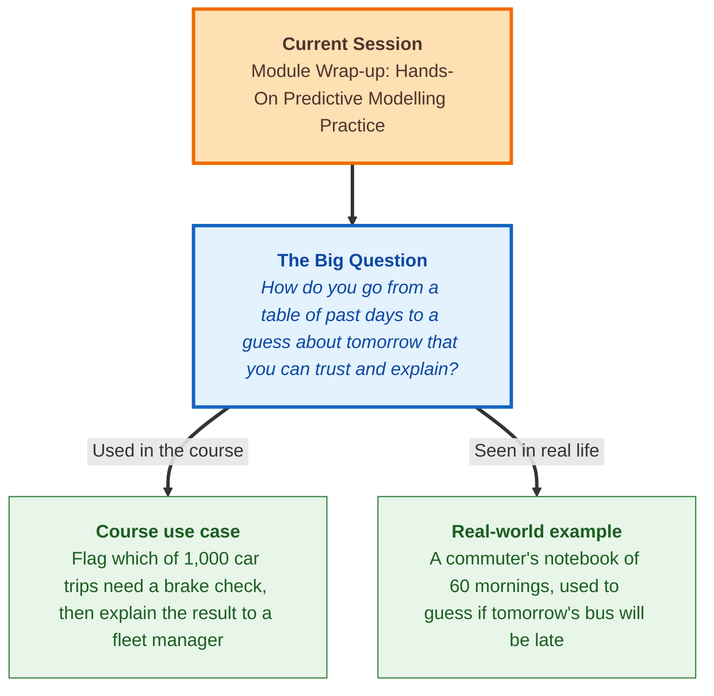

## <span style="color:#2F7DDE">Module Wrap-up: Hands-On Predictive Modelling Practice</span>

### <span style="color:#2F7DDE">Mental Map</span>



---

### <span style="color:#2F7DDE">What You'll Learn</span>

Have you ever wondered whether you could guess tonight if tomorrow's bus will be late?

By the end of this session, you will be able to:

- <span style="color:#D9660B">**Identify**</span> the answer you want to guess and the 3 details you guess it from.
- <span style="color:#D9660B">**Explain**</span> why "right on 42 of 60 mornings" can still miss every late bus.
- <span style="color:#D9660B">**Solve**</span> a full yes-or-no guessing problem, from 60 notebook rows to a final answer.
- <span style="color:#D9660B">**Compare**</span> 3 ways of guessing and pick the one that warns you about the most late buses.
- <span style="color:#D9660B">**Critique**</span> your pick: one thing it does well, one thing it gets wrong, and one fix.
- <span style="color:#D9660B">**Write**</span> a two-paragraph note that a friend with no tech background understands.

> <span style="color:#2F7DDE">**Topics you will meet:**</span> complete prediction problem, model choice, precision, recall and F1-score, model strengths and weaknesses, plain-language summary.
>
> Join the session to learn each of these in detail.

---

### <span style="color:#2F7DDE">Why You Are Learning This Topic</span>

Your morning bus is late about 3 days in 10. On those days you miss the start of class. So you start a notebook. Each morning you write down the day, whether it rained, when you left home, and whether the bus was late. After 60 mornings, can those pages warn you the night before?

A <span style="color:#D9660B">**prediction problem**</span> means using details you know now to guess an answer you will only learn later.

In your course, you will solve one from the first row of data to the final note you send.

> <span style="color:#2F7DDE">**Think about it:**</span> Which detail in your notebook would you trust most to warn you?

---

### <span style="color:#2F7DDE">The Bus Notebook Puzzle</span>

Here are 5 of the 60 mornings in your notebook.

| Day | Rain | Left home | Bus late? |
|:---:|:----:|:---------:|:---------:|
| Monday | No | 8:05 | No |
| Tuesday | Yes | 8:10 | Yes |
| Wednesday | No | 8:20 | Yes |
| Thursday | Yes | 8:05 | Yes |
| Friday | No | 8:10 | No |

<span style="color:#D9660B">**What you want to happen:**</span>

- Get a warning on the nights before most late mornings.
- Avoid waking up early on days the bus comes on time.
- Tell a friend how well your guesses work, in two short paragraphs.

Here is how it might start. You do not need to understand it yet.

```python
model = LogisticRegression().fit(X_train, y_train)
late_guess = model.predict(X_test)
print(recall_score(y_test, late_guess))
```

> <span style="color:#D9660B">**Wonder about this:**</span>
>
> - Should you test your guesses on mornings you already used to make your rule?
> - Is a missed late bus worse than an early alarm you did not need?

---

### <span style="color:#2F7DDE">Think It Through</span>

There is no wrong first try. Keep your guesses for the session.

**1. If you always guess "on time", you are right on 42 of 60 mornings. Is that a smart rule?**
Hint: Count the late buses it would warn you about.

**2. Your rule is right on every morning you used to build it. Should you trust it for next week?**
Hint: Think of a student who learns the answers to last year's paper by heart.

**3. How would you tell your friend how well your rule works, without any maths words?**
Hint: Try a sentence that starts "Out of the 18 late mornings…".

---

### <span style="color:#2F7DDE">One Question to Carry Into the Session</span>

> <span style="color:#2F7DDE">**How do you pick the best way to guess when every way gets something wrong?**</span>
>
> And how do you explain your pick to someone who has never heard of a model?
