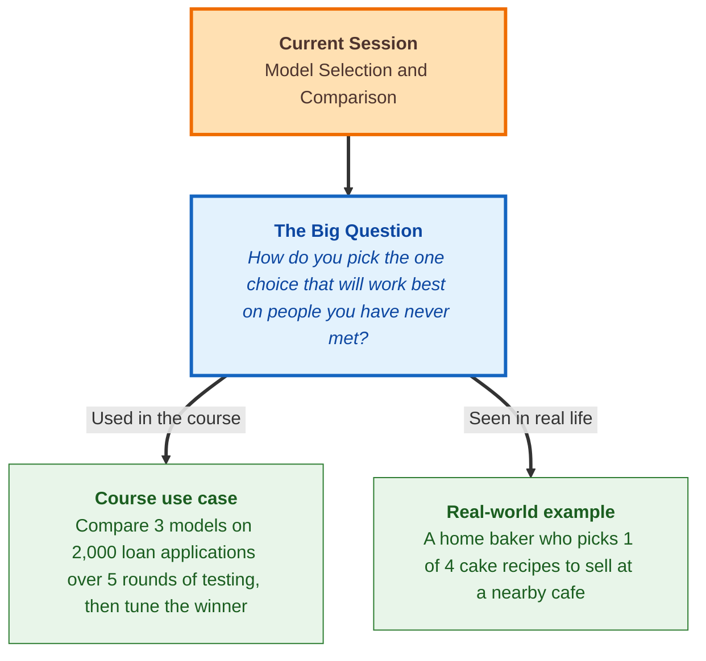

## <span style="color:#2F7DDE">Model Selection and Comparison</span>

### <span style="color:#2F7DDE">Mental Map</span>



---

### <span style="color:#2F7DDE">What You'll Learn</span>

Have you ever wondered how a baker decides which cake goes in the cafe window?

By the end of this session, you will be able to:

- <span style="color:#D9660B">**Identify**</span> which of 4 recipes pleases only your family and which pleases nobody much.
- <span style="color:#D9660B">**Explain**</span> why tasting a recipe with 5 different groups gives a fairer score than one group.
- <span style="color:#D9660B">**Calculate**</span> the number of bakes needed to try every mix of 3 oven temperatures and 3 baking times.
- <span style="color:#D9660B">**Compare**</span> all 4 recipes using the same tasting score from the same 5 groups.
- <span style="color:#D9660B">**Justify**</span> the one recipe you would sell, using both its stranger score and its number of steps.

> <span style="color:#2F7DDE">**Topics you will meet:**</span> model evaluation, bias-variance trade-off, model selection strategies, hyperparameter tuning with Grid Search and Random Search, and cross-validation.
>
> Join the session to learn each of these in detail.

---

### <span style="color:#2F7DDE">Why You Are Learning This Topic</span>

The cafe near your home wants one of your cakes to sell each day. You have 4 recipes. Your family votes for the chocolate fudge every time. But your family has eaten it 50 times. The people who buy at the cafe are strangers.

<span style="color:#D9660B">**Model selection**</span> means trying different ways of predicting and keeping the one that does well on new data.

In your course, you will compare models, tune the strongest one and explain your pick.

> <span style="color:#2F7DDE">**Think about it:**</span> Whose opinion should decide the cake: your family's or a stranger's?

---

### <span style="color:#2F7DDE">The Cafe Cake Puzzle</span>

Here are your 4 recipes, scored out of 10.

| Recipe | Family score | Average score from 5 stranger groups | Steps to follow |
|:------:|:------------:|:------------------------------------:|:---------------:|
| Chocolate Fudge | 9.5 | 6.0 | 25 |
| Plain Sponge | 6.0 | 5.8 | 6 |
| Lemon Drizzle | 8.4 | 8.1 | 10 |
| Red Velvet | 8.8 | 8.2 | 30 |

<span style="color:#D9660B">**What you want to happen:**</span>

- Every recipe is scored the same way, by the same 5 tasting groups.
- You find the right oven setting without a week of extra baking.
- You can tell the cafe owner why you picked it.

Here is how it might start. You do not need to understand it yet.

```python
grid = {"max_depth": [2, 4, 6]}
search = GridSearchCV(DecisionTreeClassifier(), grid, cv=5).fit(X, y)
print(search.best_params_)
```

> <span style="color:#D9660B">**Wonder about this:**</span>
>
> - Is one tasting group enough to trust a score?
> - If the cafe owner asks why you chose a recipe, what would you show?

---

### <span style="color:#2F7DDE">Think It Through</span>

There is no wrong first try. Keep your guesses for the session.

**1. Chocolate Fudge scores 9.5 at home but 6.0 with strangers. What went wrong?**
Hint: Think about who has tasted it 50 times already.

**2. You have 3 oven temperatures and 3 baking times. Must you bake every mix to find the right one?**
Hint: Count the mixes, then think about trying 4 mixes picked at random.

**3. Red Velvet beats Lemon Drizzle by 0.1 points, but it takes 30 steps. Which would you sell?**
Hint: Think about the helper who bakes it on the days you are away.

---

### <span style="color:#2F7DDE">One Question to Carry Into the Session</span>

> <span style="color:#2F7DDE">**How do you pick the model that will do best on data it has never seen?**</span>
>
> And how do you explain why you chose it over the others?
