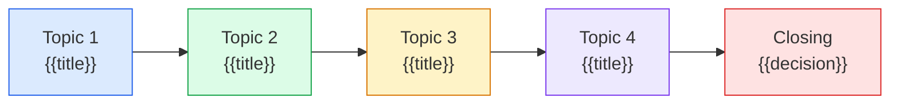

# <font color='#1d4ed8'>Lecture Script: {{SESSION_NAME}}</font>

> **Rules for this template (delete this box before use):**
> - **Format v2 (frozen).** Change the content, never the structure, the colours or the order. See `playbook.md` for how to fill it for a new topic.
> - **One Why, one What, one How per lecture.** Why = Scenario + Problem Statement. What = "What We Will Use". How = "How: Walking Through …" and the four topics. There is no Why/What/How heading inside a topic.
> - **Four topics, named "Topic 1" to "Topic 4"** (never "Step", "Block" or "Part"). Group the LOs 1–2 per topic, in teaching order. Minutes (with the Closing) add up to 120. Depth is shown by minutes and by the number of "Extending it" variations, never by a label.
> - **Four quizzes**, one at the end of each topic, aimed at the topic's main LO (about one per 30 minutes). Light LOs are checked in a quick "Extending it" and in the Closing.
> - **Inside a topic (fixed):** bridge question → Example → Extending it (one or more) → Quiz. Never label stages "I Do" or "We Do". There is no Recap.
> - **One flow.** Each topic opens from the previous result, uses the same scenario and data, and ends with a result in words.
> - **Scenario layout must vary per script** (table, story, before/after, single risk, comparison). Do not reuse the previous script's shape.
> - **"What We Will Use" stays short.** Tool-heavy topics (SQL, libraries): an intro line plus one toolkit table (Topic / Tools / In one line); put each formula or warning in the topic where the tool is first used. Maths topics may use a fuller terms table, because the formulas are the lecture's What.
> - **Colours:** title `#1d4ed8`, section and topic headings `blue`, example headings `green`, explanation headings `#c2410c`, questions `purple`, results `green`, common mistakes `#b45309`, Instructor Note `red`. Use the `<font color='…'>` tags shown below.
> - **Instructor Note:** 1–2 lines, red heading `<font color="red">**🎯 Instructor Note**</font>`. For the expected answer to a prediction, a poll answer or a warning.
> - **Code:** 10 lines or fewer, run before use, output pasted exactly under **Output**. Ask **Predict before running: What will happen?** first. Explain it under `Code Explanation`, one bullet per line or group of lines. Use `Logic Explanation` for reasoning without code.
> - **Maths:** every formula, symbol and computed value in LaTeX (`$…$`, `$$…$$`, `\boxed{}` for the key formula).
> - **Visuals:** real charts as PNG files in `images/` (drawn from the same numbers as the code, with alt text), embedded with `<p align="center"></p>`; Mermaid for flows; tables for definitions and results.
> - **Chat prompts:** write "Give learners 30 seconds to respond in chat."
> - **Facts and language:** every number, definition and output verified. Famous Indian company as the setting, as framing only; all data is invented for the scenario. Plain words in the Problem Statement; no forward references; 🎯 is the only emoji.
> - **Announcements:** keep the section only when the input says Yes.

---

## <font color='blue'>Agenda</font>

The lecture runs as four topics. Each topic ends with a quiz.

| Topic | What we do | Learning objectives covered | Minutes |
|:-:|:--|:--|:-:|
| 1 | {{short action title}} | {{LO text, verbatim}}<br>{{second LO, verbatim, if grouped}} | {{MIN}} |
| 2 | {{short action title}} | {{LO text, verbatim}} | {{MIN}} |
| 3 | {{short action title}} | {{LO text, verbatim}} | {{MIN}} |
| 4 | {{short action title}} | {{LO text, verbatim}} | {{MIN}} |
| — | Closing: Outcome & Summary | | {{MIN}} |
| | **Total** | | **120** |

> <font color="red">**🎯 Instructor Note**</font> Pace: {{which LO to keep quick, which to spend time on}}.
> {{One more pacing line, optional.}}

---

## <font color='blue'>Scenario</font>

{{2–4 lines or a small table: one real-world situation a beginner can picture, in a famous Indian company's setting. Choose the layout that fits this topic.}}

> <font color="red">**🎯 Instructor Note**</font> {{The company is only the setting; do not claim it uses this data. Where the data lives and any fixed "today" or software version.}}

---

## <font color='blue'>Problem Statement</font>

{{A short, concrete story of a mistake and its consequence for a person, in plain words.}}

> <font color='purple'>**{{THE_QUESTION_THE_LECTURE_ANSWERS}}**</font>

> <font color="red">**🎯 Instructor Note**</font> Poll: "{{poll question}}" Give learners 30 seconds to respond in chat. Reveal the answer in the Closing.

---

## <font color='blue'>What We Will Use</font>

{{Short. Either one intro line plus the toolkit table below, or (maths topics) a terms table with the key formulas in LaTeX.}}

| Topic | Tools | In one line |
|:-:|:--|:--|
| 1 | {{tools}} | {{what they do}} |
| 2 | {{tools}} | {{what they do}} |
| 3 | {{tools}} | {{what they do}} |
| 4 | {{tools}} | {{what they do}} |

---

## <font color='blue'>How: Walking Through {{the scenario}}</font>



---

## <font color='blue'>Topic 1: {{Title}}</font> `{{MIN}} min`

> <font color='purple'>**{{One-line bridge question that opens the topic from the Problem Statement.}}**</font>

### <font color='green'>Example: {{the first worked example on the scenario data}}</font>

> <font color='purple'>**{{Question this example answers.}}**</font>

{{Formula box or the same calculation in LaTeX, when mathematical; first-use formulas and warnings of a tool go here.}}

$$\boxed{ {{FORMULA}} }$$

**Predict before running: What will happen?**

> <font color="red">**🎯 Instructor Note**</font> {{Expected answer. Common wrong guess.}}

```python
{{CODE_MAX_10_LINES}}
```

**Output**

```
{{EXACT_OUTPUT}}
```

#### <font color='#c2410c'>Code Explanation</font>

- **Line 1** {{plain-English meaning}}
- **Line 2** {{plain-English meaning}}

> <font color='green'>**Result**</font> {{One sentence stating the result in words.}}

<p align="center"></p>

### <font color='green'>Extending it: {{a small variation on the same data}}</font>

> <font color='purple'>**{{A new question that changes one thing.}}**</font>

> <font color="red">**🎯 Instructor Note**</font> {{Ask for a prediction or a poll first. Expected answer.}}

```python
{{CODE}}
```

**Output**

```
{{EXACT_OUTPUT}}
```

> <font color='green'>**Result**</font> {{Result in words, and why it differs from the first example.}}

> <font color='#b45309'>**Common mistake**</font> {{Optional. Mistake and the fix.}}

{{Repeat "Extending it" as needed: more variations for a deep LO, one quick check for a light LO. For reasoning with no code, add a `#### Logic Explanation` heading in the same colour.}}

### <font color='purple'>Quiz 1</font>

**Question:** {{QUESTION}}

**Options:**
- A) {{…}}
- B) {{…}}
- C) {{…}}
- D) {{…}}

**Correct Answer:** {{LETTER}}

**Explanation:**
- **A)** {{one line: why it is correct or wrong}}
- **B)** {{one line}}
- **C)** {{one line}}
- **D)** {{one line}}

---

## <font color='blue'>Topic 2: {{Title}}</font> `{{MIN}} min`

{{Same layout as Topic 1. The bridge question opens from the result of Topic 1, and the code reuses the same data. Ends with Quiz 2.}}

---

## <font color='blue'>Topic 3: {{Title}}</font> `{{MIN}} min`

{{Same layout. Ends with Quiz 3.}}

---

## <font color='blue'>Topic 4: {{Title}}</font> `{{MIN}} min`

{{Same layout. Ends with Quiz 4.}}

---

## <font color='blue'>Closing: Outcome & Summary</font> `{{MIN}} min`

{{Return to the Problem Statement and answer it, using each topic once. The light LOs appear here in the final code.}}

> <font color='purple'>**1. {{Question that uses Topic 1}}**</font>

{{Answer.}}

> <font color='purple'>**2. {{Question that uses Topic 2 and the result before it}}**</font>

```python
{{CODE_MAX_10_LINES}}
```

**Output**

```
{{EXACT_OUTPUT}}
```

#### <font color='#c2410c'>Code Explanation</font>

- **Line 1** {{plain-English meaning, tagged with the topic it came from}}

<p align="center"></p>

### <font color='green'>Outcome</font>

| | {{Option A}} | {{Option B}} |
|:--|:-:|:-:|
| {{Measure 1}} | {{value}} | {{value}} |
| {{Measure 2}} | {{value}} | {{value}} |

> <font color='green'>**Therefore,**</font> {{the answer to the Problem Statement, in words, with the trade-off.}}

> <font color="red">**🎯 Instructor Note**</font> {{Reveal the opening poll result next to the table.}}

### <font color='green'>Summary</font>

| Learning objective | Takeaway |
|:--|:--|
| {{LO short name}} | {{one-line takeaway}} |
| {{every LO, one row each}} | {{one-line takeaway}} |
| **Practical value** | {{how this helps in the learner's work or daily life}} |

---

## <font color='blue'>Announcements</font>

> <font color="red">**🎯 Instructor Note**</font> Optional. Use this space to tell learners about upcoming activities such as projects or evaluations. By default, the mentor explains.

---

# <font color='red'>Launch the Feedback Poll</font>

> <font color="red">**🎯 Instructor Note**</font> Reminder: launch the feedback poll now to collect learner feedback.