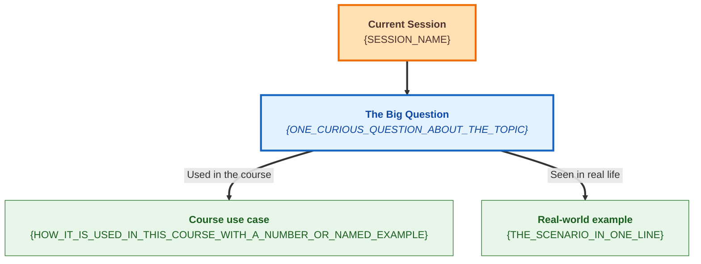

## {SESSION_NAME}

### Mental Map

---

### What You'll Learn

Have you ever wondered {HOW_A_FAMILIAR_THING_IN_THE_SCENARIO_HAPPENS_ON_ITS_OWN}?

By the end of this session, you will be able to:

- **{BLOOM_VERB_1}** {WHAT_THE_STUDENT_DOES_1_IN_PLAIN_WORDS_WITH_A_NUMBER_OR_NAMED_ITEM}.
- **{BLOOM_VERB_2}** {WHAT_THE_STUDENT_DOES_2}.
- **{BLOOM_VERB_3}** {WHAT_THE_STUDENT_DOES_3}.
- **{BLOOM_VERB_4}** {WHAT_THE_STUDENT_DOES_4}.

> **Topics you will meet:** {TOPIC_NAMES_COMMA_SEPARATED}.
>
> Join the session to learn each of these in detail.

---

### Why You Are Learning This Topic

{STORY_4_TO_6_SHORT_SENTENCES_ABOUT_THE_SCENARIO}

{DEFINE_THE_CORE_TERM_ONCE: A **term** means PLAIN_MEANING.}

{ONE_SENTENCE_LINKING_IT_TO_THE_COURSE}

> **Think about it:** {ONE_QUESTION_THE_STORY_RAISES}

---

### {SCENARIO_NAME} Puzzle

{ONE_LINE_INTRODUCING_THE_SCENARIO_DATA}

| {COLUMN_1} | {COLUMN_2} |
|:----------:|:----------:|
| {ROW_1} | {VALUE_1} |
| {ROW_2} | {VALUE_2} |
| {ROW_3} | {VALUE_3} |

**What you want to happen:**

- {WISH_1}
- {WISH_2}
- {WISH_3}

{OPTIONAL_PREVIEW: test the code before keeping it. Delete this paragraph and the code block when the topic has no code}

> **Wonder about this:**
>
> - {WONDER_QUESTION_1}
> - {WONDER_QUESTION_2}

---

### Think It Through

There is no wrong first try. Keep your guesses for the session.

**1. {QUESTION_1}**
Hint: {ONE_LINE_HINT_1}

**2. {QUESTION_2}**
Hint: {ONE_LINE_HINT_2}

**3. {QUESTION_3}**
Hint: {ONE_LINE_HINT_3}

---

### One Question to Carry Into the Session

> **{ONE_BOLD_QUESTION}**
>
> {ONE_FOLLOW_UP_QUESTION}

{SET_UP_BLOCK: when Setup = Yes, add a --- rule and the block below. When Setup = No, delete this line and the block.}

---

### Set Up Before the Session

> **Do this before the session starts.** {ONE_PLAIN_SENTENCE_NAMING_THE_TOOL_AND_WHY} {THE_PASTED_SETUP_TEXT_OR_LINK_EXACTLY_AS_GIVEN_WITH_GRAMMAR_CORRECTED}